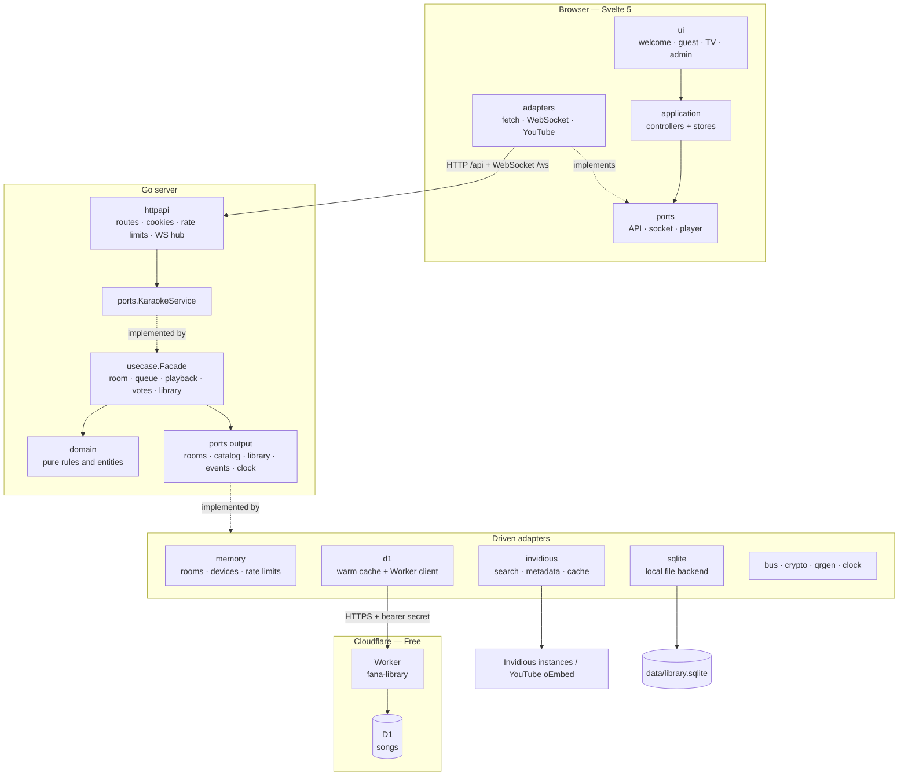

# Fana Karaoke

A browser karaoke room. Put the room on the TV, let guests scan a QR code, search YouTube for karaoke videos, upvote the queue, and vote to skip. No accounts, no installs. A durable song library remembers songs so repeat searches skip YouTube: local SQLite in development, Cloudflare D1 in production.

- **TV view** (`/tv/<secret>`) — the YouTube player, join QR, host PIN, queue drawer, and host controls.
- **Guest view** (`/r/<code>`) — phone-first search, paste-a-link, queue, upvotes, skip votes, and host controls after entering the PIN.
- Rooms are **ephemeral**: in memory, gone when the host ends them, after two hours without a host, or on restart.

The product and design rationale live in [`fana-karaoke-spec.md`](fana-karaoke-spec.md).

Created by [Fanamperantsoa Rakotoasimbola](https://github.com/fanama).

## Stack

- Go 1.25 HTTP server, in-memory room manager, WebSocket snapshots, signed cookies.
- Svelte 5 + TypeScript + Vite, built into `web/dist` and embedded with `go:embed`.
- YouTube IFrame Player API for playback; no media is downloaded or proxied.
- Public [Invidious](https://invidious.io/) instances for search and metadata, with a 24-hour cache, stale results, and YouTube oEmbed fallback.
- A song library searched before Invidious. It keeps one row per video, remembers online hits and played songs, and can be exported/imported. Development uses pure-Go [`modernc.org/sqlite`](https://pkg.go.dev/modernc.org/sqlite); production uses Cloudflare D1 through a small authenticated Worker.
- No frontend runtime server, no external font/CDN dependency at runtime. Rooms are in memory; only the song library is durable.

## Run locally

Requirements: Go 1.25+, Node 22+.

```bash
# Build the frontend once (embedded into the binary)
cd web
npm ci
npm run build
cd ..

# Run
go run ./cmd/server
# open http://localhost:8080
```

Or build one binary:

```bash
make build
./fana-karaoke
```

### Frontend development

Two terminals:

```bash
# terminal 1
DEV=true go run ./cmd/server

# terminal 2
cd web
npm run dev
# open http://localhost:5173
```

Vite proxies `/api` and `/ws` to port 8080. `DEV=true` disables rate limits and relaxes the WebSocket origin check for the Vite origin.

## Configuration

| Variable | Default | Purpose |
| --- | --- | --- |
| `PORT` | `8080` | HTTP listen port. |
| `PUBLIC_BASE_URL` | derived from request; on Render, `RENDER_EXTERNAL_URL` | Absolute origin for QR codes, join/TV links, secure cookies, and origin checks. Set it in production, e.g. `https://karaoke.example`. |
| `INVIDIOUS_INSTANCES` | `https://invidious.f5.si,https://yewtu.be,https://inv.nadeko.net,https://invidious.nerdvpn.de,https://iv.melmac.space` | Comma-separated Invidious base URLs, tried in order. Unhealthy instances are skipped for 60 s. |
| `YOUTUBE_REGION` | `FR` | Region passed to Invidious search. |
| `SESSION_SECRET` | random at boot | HMAC key for device/host cookies. Set and keep stable in production. |
| `ROOM_TTL` | `2h` | Delete a room with no host connection for this long. |
| `MAX_ROOMS` | `1000` | Server-wide room cap. |
| `MAX_GUESTS` | `25` | Concurrent guest devices per room. |
| `MAX_QUEUE` | `100` | Pending songs per room. |
| `SEARCH_CACHE_TTL` | `24h` | Fresh search-cache lifetime. |
| `SEARCH_STALE_TTL` | `168h` | Maximum age of a cached result served while Invidious is down. |
| `LIBRARY_BACKEND` | `file` | `file` (local SQLite), `d1` (Worker + Cloudflare D1), or `none`. |
| `LIBRARY_PATH` | `./data/library.sqlite` | SQLite file used only when `LIBRARY_BACKEND=file`. An empty value disables that backend. |
| `LIBRARY_PROXY_URL` | unset | Worker base URL, e.g. `https://fana-library.<subdomain>.workers.dev`. Required for `d1`. |
| `LIBRARY_PROXY_TOKEN` | unset | Shared secret with the Worker. Not a Cloudflare API token. |
| `LIBRARY_WARMUP_TIMEOUT` | `10s` | Maximum boot wait for the full D1 cache load. On timeout the app starts cache-only. |
| `LIBRARY_READ_TIMEOUT` | `10s` | D1 pagination and health timeout. |
| `LIBRARY_WRITE_TIMEOUT` | `5s` | Synchronous user-song write timeout. |
| `LIBRARY_CACHE_WRITE_TIMEOUT` | `5s` | Best-effort search-result write timeout. |
| `ADMIN_TOKEN` | unset | Enables the `/admin` page. Set a long random value, for example `openssl rand -hex 32`. Leave unset to disable the page. |
| `LOG_LEVEL` | `info` | `debug`, `info`, `warn`, `error`. |
| `TRUST_PROXY` | `false` | Use `X-Forwarded-For` for rate limits. Only enable behind a proxy that overwrites it. |
| `DEV` | `false` | Relax Secure cookies/rate limits and skip WebSocket origin checks. Never enable in production. |

Example:

```bash
PUBLIC_BASE_URL=https://karaoke.example \
SESSION_SECRET="$(openssl rand -hex 32)" \
INVIDIOUS_INSTANCES="https://invidious.f5.si" \
./fana-karaoke
```

For local development, `cmd/server` also loads `.env` from the working directory at startup when the file exists. Variables already set in the real environment always win, so production settings are never overridden. The Docker image does not contain your `.env`; pass variables with `--env-file .env` or the platform's environment settings.

## Docker

```bash
docker build -t fana-karaoke .
docker run --rm -p 8080:8080 -v fana-data:/data \
  -e PUBLIC_BASE_URL=http://localhost:8080 \
  -e SESSION_SECRET="$(openssl rand -hex 32)" \
  fana-karaoke
```

The image is a multi-stage build: Node builds the Svelte assets, Go produces a static binary, and the runtime image is Alpine with CA certificates. Rooms still have no persistent state. By default the song library lives at `/data/library.sqlite` (`LIBRARY_PATH` is preset in the image); mount a volume to keep it across container replacements. Set `LIBRARY_BACKEND=d1` and the two Worker variables to use D1 instead.

## Deploy on Render

The repository ships a [`render.yaml`](render.yaml) Blueprint:

1. Push the repository to GitHub and open **New → Blueprint** in the Render dashboard.
2. Select the repo; Render detects `render.yaml` and creates the `fana-karaoke` web service.
3. Apply. The first build takes a few minutes; the health check is `/healthz`.

The Blueprint builds the existing Dockerfile, keeps `TRUST_PROXY=true` (Render's proxy overwrites `X-Forwarded-For`), and generates a stable `SESSION_SECRET`. `PUBLIC_BASE_URL` falls back to `RENDER_EXTERNAL_URL`, so QR codes, absolute links, Secure cookies and WebSocket origin checks work without extra configuration.

**The library needs Cloudflare D1 on the free plan.** Render Free has no persistent disk, so a local SQLite file is erased on every redeploy, restart, or spin-down. Deploy the Worker once, then paste its URL and secret into Render:

```bash
cd workers/library
npm install
npx wrangler login
npx wrangler d1 create fana-library --location=weur
# copy the database id into wrangler.toml
npx wrangler d1 migrations apply fana-library --remote
openssl rand -hex 32
npx wrangler secret put LIBRARY_PROXY_TOKEN
npx wrangler deploy
```

Set `LIBRARY_BACKEND=d1`, `LIBRARY_PROXY_URL` and `LIBRARY_PROXY_TOKEN` in the Render dashboard. See [`workers/library/README.md`](workers/library/README.md) for the full runbook, local development, and optional CI deployment. No Cloudflare API token is stored in Render: the Worker holds the D1 binding, and Render only knows the Worker URL and a shared secret.

To deploy manually instead: **New → Web Service**, runtime **Docker**, health check path `/healthz`, and the same environment variables.

**Constraints**

- Run **exactly one instance**. Room state and the WebSocket hub are process-local; scaling out breaks rooms and live updates.
- The free plan spins down after 15 minutes without traffic, which ends all rooms and adds a cold-start delay. Use a paid instance for an event.
- With a custom domain, set `PUBLIC_BASE_URL` explicitly (for example `https://karaoke.example`) so links and cookies use that origin.
- Deploys restart the process: rooms are lost and clients reconnect automatically. The D1 library survives.
- D1 Free limits: 5 million rows read/day, 100,000 rows written/day, 500 MB per database. A 2,000-song library is well under 1 MB and uses about 2,000 reads per Render wake. Limits reset at 00:00 UTC; data is not lost when a limit is hit.
- If D1 is unreachable or at its daily limit, the service starts cache-only: reads and online search still work, but new songs are rejected with `library_unavailable` until storage recovers.

## Public deployment notes

- Terminate TLS at a reverse proxy and set `PUBLIC_BASE_URL` to the HTTPS origin. Phone QR scanning and Secure cookies expect HTTPS.
- Forward WebSocket upgrades on `/ws` (`Upgrade`/`Connection`), disable response buffering/compression for that path, and keep idle timeouts above 60 s.
- Run **one instance**. Room state and the WebSocket hub are process-local; horizontal scaling would need shared state and pub/sub.
- Set `SESSION_SECRET`. If it changes, existing host/device cookies are invalidated (the rooms themselves are lost on restart anyway).
- Set `TRUST_PROXY=true` only when the proxy overwrites `X-Forwarded-For`; otherwise rate limits can be spoofed.
- For the file backend, mount a persistent volume for `LIBRARY_PATH` (or leave it unset to disable the library). For the free Render deployment, use `LIBRARY_BACKEND=d1`; no disk is required.
- `/healthz` is liveness-only and does not depend on Invidious or the library, so a D1 outage never puts Render into a restart loop.

## Search behavior

- The library is searched first, matching every query word against the title and channel (accent-insensitive). With D1, search runs entirely against a warm in-memory cache loaded at boot; a hit returns instantly and never calls Invidious.
- User-added songs (including pasted links) wait for the durable write before entering the queue. Online search hits are cached in memory immediately and written to D1 best-effort, so search never waits for the database.
- Hosts can **Export** the library as a `.sqlite` file and **Import** one back from **Manage**. The admin page also offers a SQL dump. Import merges: known videos are refreshed, never duplicated.
- Queries are normalized and ` karaoke` is appended unless the query already contains it.
- Live streams, videos longer than 10 minutes, videos under 60 seconds, and videos whose owners disabled embedding are filtered out.
- Results are cached for 24 hours and stale results can be served for up to a week with a banner.
- Pasting a YouTube URL always works. Metadata comes from Invidious first, then YouTube oEmbed (duration may be unknown until the player reports it).
- Public Invidious instances are third-party services and can fail or rate-limit. Point `INVIDIOUS_INSTANCES` at a reliable instance (or a self-hosted one) for production. No YouTube Data API key is required.

## Admin page

Set a token and open `/admin`:

```bash
ADMIN_TOKEN="$(openssl rand -hex 32)" \
LIBRARY_PATH=./data/library.sqlite \
./fana-karaoke
```

Or put `ADMIN_TOKEN=…` in a local `.env` file and restart the server; `.env` is loaded automatically. `.env` is ignored by Git.

The page asks for the token once and keeps a signed, HttpOnly cookie for 24 hours. It shows the storage backend (Cloudflare D1, local SQLite, or disabled), connection and cache-only state, the song count, the last successful sync, and a sanitized storage error. It can download and upload both a `.sqlite` file and the app's SQL dump without creating duplicates. The room **Manage** panel keeps the `.sqlite`-only transfer.

SQL import accepts only the dump format this app generates (it starts with `-- fana-karaoke-library v1`); arbitrary SQL is rejected. The admin import is sent as one atomic D1 batch and the cache is updated only after D1 confirms it.

Without `ADMIN_TOKEN`, `/admin` explains that the page is disabled and the admin API answers `404`. The admin cookie is signed with `SESSION_SECRET`; rotating that secret logs admins out.

## Rules in brief

- Host access: secret `/tv/<token>` link + a random 4-digit PIN for the phone.
- Queue: upvote-sorted; new songs start at the bottom; once the host reorders, **host order wins** for the rest of the room.
- Upvotes: one toggle per device per song; the same video can be queued multiple times.
- Skip vote: available to people who own a queued song or are currently singing. 60 seconds, majority of the frozen eligible set, 30-second cooldown after failure. Hosts can skip directly.
- Auto-advance: 5-second countdown, cancellable by the host.
- Playback failure: auto-skip with a room notice.
- Refresh the TV: it reloads the current video and seeks to the server-known position.
- Multiple TVs: each plays independently and follows the same host commands.

## Architecture

Hexagonal architecture (ports & adapters) with a functional domain core. Dependencies point inward: the domain knows nothing about HTTP, storage, or Svelte; use cases only know the domain and the port interfaces.



```text
cmd/server/                       composition root: main.go, config.go, wire.go
internal/domain/                  pure core: entities + rules (room, queue, playback,
                                  voting, video, notice, snapshot/views, errors)
internal/ports/                   input.go (KaraokeService facade), output.go (repositories,
                                  event publisher, catalog, clock, IDs, signer, QR, limiter)
internal/usecase/                 room, queue, playback, vote and lifecycle services
                                  behind a single Facade
internal/adapters/primary/httpapi transport: routes, handlers, middleware, session cookies,
                                  SPA, WebSocket hub and handler
internal/adapters/secondary/      memory (room/device repos, rate limiter), invidious
                                  (client, parser, oEmbed prober, cache), d1 (warm
                                  D1 library), sqlite (local file library),
                                  crypto (IDs, HMAC signer), qrgen, clock, bus
internal/architecture/            automated layer and size checks
```

```text
web/src/domain/                   pure TypeScript: models, playback math, room code,
                                  autoplay policy
web/src/ports/                    contracts: API, socket, player, browser, DI context
web/src/application/              controllers and stores (welcome, guest, tv, i18n);
                                  no direct fetch, WebSocket or window.YT
web/src/adapters/                 fetch API, WebSocket, YouTube IFrame player, browser APIs
web/src/ui/                       Svelte components: common, welcome, guest, tv
web/src/styles/                   tokens, base, components
```

**Backend.** `internal/domain` is a set of pure functions over copied room state: no I/O, no mutexes, no transport types. `internal/usecase` orchestrates them through the driven ports (rooms, devices, clock, IDs, catalog, event publisher) in a `usecase.Deps` bundle. `internal/adapters/primary/httpapi` implements the driving side: it depends on the `ports.KaraokeService` interface, owns cookies, origin/CSRF checks, rate limits, QR responses and the WebSocket hub. `internal/adapters/secondary/*` provide the concrete driven adapters. `cmd/server/wire.go` is the only production code that constructs concrete types and wires them together; the event `bus` is connected to the hub there instead of via post-construction setters.

**Frontend.** `main.ts` builds the production adapters once and `App.svelte` exposes them through a Svelte context (`web/src/ports/context.ts`). Views ask `getAppContext()` for their dependencies and instantiate an application controller; UI components never import `adapters`, and the controllers never touch `fetch`, `WebSocket` or `window.YT` directly.

**Data flow.** Mutations go through HTTP; the use case persists the new room state and publishes room-updated / room-ended events on the bus, which the hub turns into full `snapshot` messages (and a final `roomEnded` before closing) over WebSockets. The TV sends playback telemetry (`tvEnded`, `tvError`, `tvProgress`) back over the same socket.

Layer isolation and the 300-line file / 40-line function limits are enforced by `go test ./internal/architecture/...`. The full rationale and dependency matrix are in [`ddd-architecture-spec.md`](ddd-architecture-spec.md).

## Verify

```bash
go test ./... -race
go vet ./...
gofmt -l .
cd web && npm run check && npm run build
cd ../workers/library && npm test && npm run check
```

Browser flows (requires Chrome installed and the server running on port 8090):

```bash
# terminal 1
PORT=8090 DEV=true PUBLIC_BASE_URL=http://localhost:8090 go run ./cmd/server

# terminal 2
cd web
node e2e/flow.mjs
node e2e/autoplay.mjs
node e2e/audit.mjs
node e2e/voting.mjs
```

The scripts exercise create/join, QR, paste-add, host unlock, live queue updates, countdown, drawer, end room, autoplay with and without a user gesture, French locale, responsive overflow, search results, and a majority skip vote.

## Limitations

- Rooms and host sessions are lost on restart. This is intentional. Only the song library persists.
- The D1-backed library depends on Cloudflare's free tier and the Worker. If D1 is unavailable or at its daily limit, reads continue from cache but new songs are rejected until it recovers. There is no retry queue for best-effort search-result writes.
- The library stores song metadata (id, title, channel, thumbnail, duration), not audio or video.
- The public Invidious dependency is best-effort; search can be unavailable while URL paste keeps working.
- The 4-digit PIN is a convenience, not authentication — it is displayed on the TV. The secret TV token is what protects remote host access.
- YouTube playback requires the official iframe player; the video is never hidden or downloaded.
- Autoplay: the TV tries to start each song with sound. If the browser refuses (no prior interaction, strict TV browser), playback starts muted instead of stalling and a **Tap for sound** chip appears — one tap anywhere on the TV restores audio. A hard block still shows **Tap to resume**.
- Not implemented: lyrics overlay, scoring, vocal removal, saved playlists, accounts, moderation, native apps.
