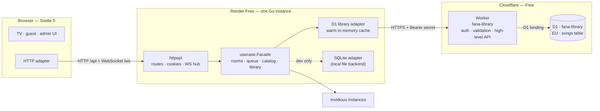

# Cloudflare D1 Storage for the Render Free Deployment

**Status:** Draft — awaiting approval  
**Date:** 2026-10-24  
**Scope:** Song-library persistence only. No rewrite of rooms, WebSockets, search, playback, or the Svelte UI beyond the admin library controls.  
**Related documents:** [`README.md`](README.md), [`fana-karaoke-spec.md`](fana-karaoke-spec.md), [`ddd-architecture-spec.md`](ddd-architecture-spec.md)

---

## 1. Summary

Keep the Go + Svelte application on Render's **free** web-service plan and move the song library from the ephemeral `/data/library.sqlite` file to **Cloudflare D1**, reached through a small **Cloudflare Worker proxy**.

```text
Browser ──HTTP/WS──> Render (Go, free) ──HTTPS + shared secret──> Worker ──D1 binding──> D1 (EU)
                          │
                          └── in-memory warm cache of the library
```

The library survives Render redeploys, restarts, and free-plan spin-downs. Rooms remain in process memory and are still lost on restart, which is intentional.

The Worker is necessary because the chosen constraint is **no long-lived Cloudflare API token in Render**. The Worker owns the D1 binding; Render only knows a Worker URL and a random shared secret. The secret is not a Cloudflare API token and grants access only to the Worker's four song endpoints.

### Decision in one sentence

Use **Render Free + one Cloudflare Worker + one free D1 database in Europe**, keep a warm in-memory search cache on Render, write user-added songs synchronously, write online search results best-effort, and expose the library through the existing admin page with both `.sqlite` and SQL transfer formats.

---

## 2. Problem and constraints

### 2.1 Current state

- Render runs one Docker instance of the Go server on the free plan.
- Rooms, the WebSocket hub, devices, and rate limits are **process-local**.
- The song library is `modernc.org/sqlite` at `LIBRARY_PATH` (`/data/library.sqlite` in the image).
- Render Free has an **ephemeral filesystem** and does not support persistent disks. Every redeploy, restart, or spin-down deletes the library file.
- Render Free spins down after 15 minutes without inbound traffic and takes about a minute to wake.
- The library is searched before Invidious and is the only persistent data in the product.

### 2.2 Constraints and preferences captured during the interview

| Topic | Decision |
| --- | --- |
| What must be fixed first | Persist the song library |
| Implementation scope | Storage adapter only; no rewrite of rooms or WebSockets |
| Budget | Strict $0, no credit card |
| Expected library size | Under 2,000 songs |
| Usage | A few parties per month |
| D1 access | Worker proxy with a shared secret; **no manual Cloudflare API token in Render** |
| Worker API surface | High-level song endpoints only; no arbitrary SQL from Render |
| Worker deployment | `wrangler login` browser OAuth locally; CI path documented as optional |
| Search | Warm in-memory cache on Render |
| User-added songs | Wait for D1 before the song is queued |
| Online search results | Best effort; search results do not wait for D1 |
| D1 failure at boot | Wait up to 10 seconds, then start cache-only |
| Adds while D1 is down | Reject the add; do not pretend it is durable |
| Admin import failure | Fail the whole import; do not apply it to the cache |
| Transfer formats | `.sqlite` and SQL, both import and export |
| SQL import | Only the app's own dump format, never arbitrary SQL |
| SQL surface | Admin only; the room **Manage** panel keeps `.sqlite` |
| D1 location | Europe |
| Worker code | In this repository under `workers/library` |
| Admin status | Connection and sync state (not daily usage, not a test button) |
| Cloudflare account | Does not exist yet; the spec includes the full setup |
| Existing data | Start fresh; optional one-time export from the old instance |

### 2.3 Non-goals

- Rewriting the Go server for Cloudflare Workers or Durable Objects.
- Persisting rooms, playback state, host sessions, or devices. Those stay in memory and are lost on restart by design.
- Horizontal scaling or multiple Render instances.
- A D1-side search index, FTS5 table, or SQL search endpoint. Search stays in the Render cache.
- Automatic scheduled backups. Admin export and D1's 7-day Time Travel are the backup story.
- A custom domain, paid Cloudflare plan, paid Render disk, or any new paid service.
- A general-purpose SQL console or arbitrary SQL import.
- Changing the Invidious search behavior, YouTube playback, room rules, or the guest/TV UI outside the admin library controls.
- A SQL format selector in the room **Manage** panel.

### 2.4 Success criteria

A party can run with the Render service waking from sleep, add songs, search the local library, and survive a Render redeploy without losing the library. The Cloudflare bill stays **$0** and no payment method is attached. The admin page shows whether D1 is connected and when the last successful sync happened. Both library transfer formats round-trip.

---

## 3. Options considered

### Option A — Render persistent disk

**Rejected.** Persistent disks require a paid Render instance. The free plan does not support them, and the user's budget is strictly $0.

### Option B — Render calls the D1 REST API directly

**Rejected.** It works technically, but requires a long-lived Cloudflare API token with D1 edit permission stored in Render. That conflicts with the explicit preference to avoid manual Cloudflare tokens in Render, and a leaked token would expose the whole D1 API surface rather than four narrow operations.

### Option C — Render + Worker proxy + D1

**Chosen.** The Worker holds the D1 binding; Render holds only a Worker URL and a random shared secret. The Worker exposes only high-level, validated song operations. D1 remains free. The Worker is also free on the Workers Free plan for this traffic level.

### Option D — Deploy everything on Cloudflare

**Out of scope for this change.** It requires porting the Go HTTP/WebSocket server and the in-process room model to Cloudflare Workers and Durable Objects, plus a new static-asset and WebSocket architecture. That is a separate project with different limits; the user explicitly chose the storage-adapter-only scope. It remains a possible future direction, but it is not part of this spec.

### Option E — Another hosted SQLite service

Not selected. D1 is the requested direction and fits the free-tier constraints. No additional vendor is introduced.

---

## 4. Free-tier budget

All figures below come from the official Cloudflare and Render documentation cited in §21.

### 4.1 Limits that matter

| Service | Free-plan limit | Impact on Fana |
| --- | --- | --- |
| D1 rows read | 5 million/day | Boot loads 2,000 rows; a wake costs ~2,000 reads |
| D1 rows written | 100,000/day | One user add = 1 row; one import = up to 2,000 rows |
| D1 storage | 5 GB per account; 500 MB per database; 10 databases | 2,000 songs is well under 1 MB |
| D1 Time Travel | 7 days | Point-in-time restore available for free |
| D1 bound parameters | 100 per query | 8 columns × 10 songs = 80 parameters per statement |
| D1 SQL statement length | 100 KB | Well under |
| D1 query duration | 30 seconds | A 2,000-row batch import must finish within this |
| D1 subrequests per Worker invocation | 50 | The Worker uses 0–1 D1 subrequests per request |
| Workers requests | 100,000/day | A few hundred per day at most |
| Workers CPU | 10 ms per invocation | The Worker only validates JSON and builds D1 statements |
| Workers memory | 128 MB | A 2,000-song JSON body is under 1 MB |
| Render free instance hours | 750/month | One service is ~730 hours if always awake; spin-down saves hours |
| Render filesystem | Ephemeral | This is exactly why D1 is needed |
| Render bandwidth | Included monthly amount; overage with no payment method suspends free services | Library traffic is tiny, but see the outbound-traffic caveat |

**Important 2026 change:** since **1 September 2026**, D1 on the Workers Free plan returns errors after the daily read or write limit is exceeded, and queries fail until **00:00 UTC**. Stored data is not lost. The application must treat this as a temporary storage outage, not as data corruption.

### 4.2 Expected monthly usage

Assumptions: 2,000 songs, 8 parties per month, 2 hours per party, 50 searches per party, 20 online results per search, 20 new songs per party.

| Operation | Rows read | Rows written | Worker requests |
| --- | ---: | ---: | ---: |
| Cold boot / wake (full cache load) | 2,000 | 0 | ~4 (500-song pages) |
| Online search cache write (20 results) | 0 | 20 | 1 |
| User adds a song | 0 | 1 | 1 |
| Admin import (2,000 songs) | 0 | 2,000 | 1 |
| **Per party** | ~2,000 per wake | ~1,000 + adds | ~60 |
| **Per month (8 parties)** | ~16,000–40,000 | ~8,000–10,000 | ~500 |

This is far below the daily limits. Even 50 Render wakes per day would be 100,000 reads/day, still under 5 million. The design intentionally **does not** query D1 for searches, counts, or admin status counts; those come from the in-memory cache.

### 4.3 Caveats

- D1 writes are counted per row. The D1 table intentionally has **no secondary index** on `search_text`, because D1 is not used for search. This avoids the extra written row that an index would add on every upsert.
- Render Free may suspend a service that initiates an uncommonly high volume of outbound traffic (for example, repeatedly calling an external database). The Worker traffic here is a handful of small requests per minute during a party. This is acceptable for the expected usage, but it is a platform risk to monitor.
- Render's free plan is explicitly not marketed for production. This design keeps the application within the free plan but does not remove Render's sleep, restart, or single-instance limitations.
- Cloudflare's free plan does not require a credit card. Render's free plan does not require one either. Do not attach a payment method unless a future decision changes the budget.

---

## 5. Target architecture

### 5.1 Diagram



### 5.2 Components

| Component | Responsibility |
| --- | --- |
| Render Go server | Serves the SPA, API, and WebSocket hub; owns rooms, playback, votes, and the warm library cache |
| `internal/adapters/secondary/d1` | Implements `ports.SongLibrary` over the Worker API; owns warm cache, search, sync save, best-effort cache writes, status, and transfer formats |
| Cloudflare Worker `fana-library` | Authenticates Render, validates payloads, translates high-level operations into parameterized D1 statements, returns JSON |
| D1 database `fana-library` | Durable `songs` table; no search index; EU primary location |
| Existing SQLite adapter | Kept for local development, tests, Docker file mode, and `.sqlite` compatibility |

### 5.3 Why the Worker sits in the middle

- No Cloudflare API token is stored in Render.
- The Worker exposes only four operations, not arbitrary SQL. A compromised Render environment cannot drop tables or read other Cloudflare resources.
- Payload validation and batching live in one place.
- The D1 database ID and account ID never leave Cloudflare configuration.
- The Worker can return sanitized errors and map D1 free-tier limit errors to a stable code.

The trade-off is one more deployable and one more network hop. For this workload (a few small requests per minute), the hop is irrelevant.

---

## 6. Data model

### 6.1 D1 schema

```sql
CREATE TABLE IF NOT EXISTS songs (
  video_id         TEXT PRIMARY KEY,
  title            TEXT NOT NULL,
  channel          TEXT NOT NULL DEFAULT '',
  thumbnail_url    TEXT NOT NULL DEFAULT '',
  duration_seconds INTEGER NOT NULL DEFAULT 0,
  search_text      TEXT NOT NULL DEFAULT '',
  first_seen_at    TEXT NOT NULL,
  last_seen_at     TEXT NOT NULL
);
```

Notes:

- The schema matches the existing SQLite library so `.sqlite` exports remain compatible.
- `search_text` is retained for file-format compatibility, but **D1 does not index it** and never searches it. The Render cache computes and uses the same normalized text.
- Timestamps are RFC 3339 UTC strings.
- `video_id` is the YouTube 11-character ID and the deduplication key.
- Upserts preserve `first_seen_at` and refresh `last_seen_at`, matching the current SQLite behavior.
- No `PRAGMA journal_mode=WAL` is needed; D1 manages storage.
- No migration framework beyond Wrangler's D1 migrations is introduced.

### 6.2 Size estimate

A row is roughly 250–400 bytes depending on title, channel, thumbnail URL, and search text. 2,000 rows are well under 1 MB. The free database limit is 500 MB per database and 5 GB per account.

### 6.3 Migration file

`workers/library/migrations/0001_songs.sql` contains the schema above. It is applied with:

```bash
cd workers/library
npx wrangler d1 migrations apply fana-library --remote
```

Local development uses the same migration with `--local`.

### 6.4 Data ownership

The library stores only public YouTube metadata (video ID, title, channel, thumbnail URL, duration) and timestamps. It does not store nicknames, device IDs, room codes, host tokens, or playback history. No audio or video is stored.

---

## 7. Worker proxy contract

### 7.1 Project layout

```text
workers/library/
  package.json
  package-lock.json
  wrangler.toml
  tsconfig.json
  migrations/
    0001_songs.sql
  src/
    index.ts          # fetch entrypoint and router
    auth.ts           # constant-time bearer check
    http.ts           # JSON responses, body limits, method helpers
    validate.ts       # song validation and normalization fallback
    songs.ts          # GET /v1/songs, pagination
    upsert.ts         # POST /v1/songs/upsert, chunked statements
    import.ts         # POST /v1/songs/import, one atomic batch
    health.ts         # GET /v1/health
    errors.ts         # sanitized error mapping, D1 limit detection
  test/
    worker.test.ts
    validation.test.ts
  README.md
```

Each TypeScript file stays under 300 lines and each function under 40 lines, because the repository's architecture tests scan all `.ts` files. The Worker is TypeScript, deployed by Wrangler with no bundler configuration beyond Wrangler's defaults.

### 7.2 Authentication

Every request requires:

```http
Authorization: Bearer <LIBRARY_PROXY_TOKEN>
```

- The token is a random 32-byte value, hex-encoded (64 characters), generated locally with `openssl rand -hex 32`.
- It is stored as a Worker secret (`wrangler secret put LIBRARY_PROXY_TOKEN`) and as a Render environment variable.
- The Worker compares it in constant time. A missing or wrong token returns `401` with `{"error":{"code":"unauthorized","message":"Unauthorized."}}`.
- The token is never written to logs, responses, the repository, or `wrangler.toml`.
- The Worker URL is not treated as a secret. It is public; the token is the security boundary.

This is **not** a Cloudflare API token. It grants access only to this Worker's routes.

### 7.3 Endpoints

#### `GET /v1/health`

Checks the D1 binding with `SELECT 1`.

**Response 200**

```json
{ "ok": true }
```

**Response 503** when D1 is unavailable or the free daily limit is exhausted:

```json
{ "error": { "code": "d1_unavailable", "message": "Database unavailable." } }
```

#### `GET /v1/songs?limit=500&offset=0`

Returns one page of songs ordered by `video_id` for stable pagination.

- `limit`: default `500`, maximum `500`.
- `offset`: default `0`, non-negative integer.
- Unknown query parameters are ignored.
- The response does **not** include a total count; the Render cache owns the count.

**Response 200**

```json
{
  "songs": [
    {
      "videoId": "dQw4w9WgXcQ",
      "title": "Example Karaoke",
      "channel": "Example Channel",
      "thumbnailUrl": "https://i.ytimg.com/vi/dQw4w9WgXcQ/mqdefault.jpg",
      "durationSeconds": 213,
      "searchText": "example karaoke example channel",
      "firstSeenAt": "2026-10-24T18:00:00Z",
      "lastSeenAt": "2026-10-24T18:00:00Z"
    }
  ],
  "nextOffset": 500
}
```

`nextOffset` is omitted when the page is the last one.

#### `POST /v1/songs/upsert`

Used for user-added songs and best-effort search-result writes.

**Request**

```json
{
  "songs": [
    {
      "videoId": "dQw4w9WgXcQ",
      "title": "Example Karaoke",
      "channel": "Example Channel",
      "thumbnailUrl": "https://i.ytimg.com/vi/dQw4w9WgXcQ/mqdefault.jpg",
      "durationSeconds": 213,
      "searchText": "example karaoke example channel",
      "firstSeenAt": "2026-10-24T18:00:00Z",
      "lastSeenAt": "2026-10-24T18:00:00Z"
    }
  ]
}
```

- Maximum **100 songs** per request.
- The Worker chunks the list into SQL statements of at most **10 songs** (8 bound parameters each, 80 total, below D1's 100-parameter limit).
- The chunks are sent in one `env.DB.batch()` call.
- Duplicate `videoId`s inside the request are collapsed; the last occurrence wins.
- Response: `{"written": <distinct songs written>}`.

#### `POST /v1/songs/import`

Used only by an admin import after the whole file has been validated.

- Maximum **2,000 songs** per request.
- The Worker chunks into statements of 10 songs and sends **one** `env.DB.batch()` with all statements. D1's `batch()` is a transaction: if a statement fails, the sequence is rolled back.
- This gives the admin import all-or-nothing semantics for the expected library size.
- Response: `{"written": <distinct songs written>}`.
- If the 2,000-song batch exceeds the Worker's 10 ms CPU budget in practice, reduce `MaxImportSongs`; do **not** split the import into multiple non-atomic requests.

#### Unknown routes

Return `404` with `{"error":{"code":"not_found","message":"Not found."}}`. No debug or schema information is returned.

### 7.4 Validation rules

The Worker validates every song before building SQL:

| Field | Rule |
| --- | --- |
| `videoId` | exactly 11 characters matching `[A-Za-z0-9_-]{11}` |
| `title` | trimmed, non-empty, at most 300 characters |
| `channel` | at most 200 characters; empty allowed |
| `thumbnailUrl` | at most 500 characters; empty or `https://`/`http://` URL |
| `durationSeconds` | integer 0–36,000 |
| `searchText` | at most 1,000 characters; if empty, the Worker computes `lower(title + " " + channel)` |
| `firstSeenAt`, `lastSeenAt` | RFC 3339 or empty; empty is replaced with the current UTC time |
| Request body | at most 2 MB |
| `songs` array | 1–100 for upsert, 1–2,000 for import |

Invalid input returns `400` with `{"error":{"code":"invalid_song","message":"Invalid song payload."}}`. A too-large body returns `413`. The Worker never echoes field values in errors.

### 7.5 SQL construction

For a chunk of up to 10 songs:

```sql
INSERT INTO songs (
  video_id, title, channel, thumbnail_url, duration_seconds,
  search_text, first_seen_at, last_seen_at
) VALUES (?, ?, ?, ?, ?, ?, ?, ?), ...  -- up to 10 rows
ON CONFLICT (video_id) DO UPDATE SET
  title = excluded.title,
  channel = excluded.channel,
  thumbnail_url = excluded.thumbnail_url,
  duration_seconds = excluded.duration_seconds,
  search_text = excluded.search_text,
  first_seen_at = songs.first_seen_at,
  last_seen_at = excluded.last_seen_at;
```

Every value is bound, never interpolated. The `first_seen_at` column keeps the original insertion time; `last_seen_at` moves forward.

### 7.6 D1 error handling

The Worker maps D1 errors to stable codes:

| Condition | HTTP | Worker code |
| --- | ---: | --- |
| Missing/wrong bearer | 401 | `unauthorized` |
| Invalid JSON, fields, or limits | 400/413 | `invalid_request` / `invalid_song` / `too_large` |
| D1 daily row read limit | 503 | `d1_limit_reached` |
| D1 daily row write limit | 503 | `d1_limit_reached` |
| Other D1 failure | 503 | `d1_unavailable` |
| Unexpected Worker exception | 500 | `internal_error` |

The Worker detects the free-tier limit messages (`daily row read limit`, `daily row write limit`) in the D1 exception and returns `d1_limit_reached`. Raw SQL, database IDs, account IDs, and stack traces are never returned to Render.

### 7.7 Worker configuration

`wrangler.toml`:

```toml
name = "fana-library"
main = "src/index.ts"
compatibility_date = "2026-10-01"
workers_dev = true

[[d1_databases]]
binding = "DB"
database_name = "fana-library"
database_id = "<copied from wrangler d1 create>"
migrations_dir = "migrations"
```

- `workers_dev = true` provides the free `https://fana-library.<account-subdomain>.workers.dev` URL. No custom domain is required.
- The database ID is not a secret; it is committed in `wrangler.toml`.
- No route, cron trigger, queue, KV, or R2 binding is added.
- No runtime npm dependencies are required; `wrangler`, `typescript`, and test tooling are dev dependencies.

### 7.8 Worker tests

- Pure validation tests: valid IDs, titles, durations, timestamps, duplicate collapsing, bounds.
- Auth tests: missing, wrong, and correct token; constant-time helper behavior.
- Router tests: wrong method/path returns 404/405; body limit returns 413.
- D1 integration tests with a local Miniflare D1:
  - Migration creates the table.
  - Upsert inserts and updates without duplicates, preserving `first_seen_at`.
  - Pagination returns stable pages and `nextOffset`.
  - Import is a single batch and rolls back on a forced failure.
  - Health returns 200/503 appropriately.
- A manual `wrangler dev --local` smoke test is part of the implementation checklist.

Use Vitest with the official Cloudflare Workers pool if it is compatible with the pinned Wrangler version; otherwise keep pure tests in Vitest and run the D1 integration through `wrangler dev --local` plus `curl`. The spec prefers the official pool, but does not make the implementation depend on an unstable test adapter.

---

## 8. Render application changes

### 8.1 Configuration

Add to `cmd/server/config.go` and `settings`:

| Variable | Default | Meaning |
| --- | --- | --- |
| `LIBRARY_BACKEND` | `file` | `file`, `d1`, or `none` |
| `LIBRARY_PATH` | `./data/library.sqlite` | Used only when `LIBRARY_BACKEND=file` |
| `LIBRARY_PROXY_URL` | unset | Worker base URL, e.g. `https://fana-library.<subdomain>.workers.dev` |
| `LIBRARY_PROXY_TOKEN` | unset | Shared secret; same value as the Worker secret |
| `LIBRARY_WARMUP_TIMEOUT` | `10s` | Maximum boot wait for the full D1 cache load |
| `LIBRARY_READ_TIMEOUT` | `10s` | Timeout for a paginated load or health check |
| `LIBRARY_WRITE_TIMEOUT` | `5s` | Timeout for a synchronous user-song write |
| `LIBRARY_CACHE_WRITE_TIMEOUT` | `5s` | Timeout for a best-effort search-result write |

Rules:

- `LIBRARY_BACKEND=file`: current behavior, local SQLite at `LIBRARY_PATH`.
- `LIBRARY_BACKEND=none`: no library adapter; search goes online, adds still work but are not remembered; admin reports the library disabled. This preserves the existing “library disabled” development mode.
- `LIBRARY_BACKEND=d1`:
  - `LIBRARY_PROXY_URL` and `LIBRARY_PROXY_TOKEN` are required for durable mode.
  - If either is missing, log an error, start with an empty cache in **cache-only** mode, and make the admin status show `storage_configuration_error`. Do not crash-loop the free Render service.
  - In production, require `https://` for the URL. Allow `http://localhost` or `http://127.0.0.1` only when `DEV=true`.
- `TRUST_PROXY`, `PUBLIC_BASE_URL`, `SESSION_SECRET`, and `ADMIN_TOKEN` are unchanged.

Add a startup warning when:

- `LIBRARY_BACKEND=d1` but the URL or token is missing.
- The URL is plain HTTP outside local development.
- The token is shorter than 32 characters.
- The warm load failed or timed out.

### 8.2 Composition root

`cmd/server/wire.go` selects the adapter:

```text
LIBRARY_BACKEND=file -> songdb.Open(LIBRARY_PATH)
LIBRARY_BACKEND=d1   -> d1.New(d1.Config{...}); Warm(ctx, 10s)
LIBRARY_BACKEND=none -> nil
```

The D1 adapter is constructed with:

- Worker base URL
- Shared token
- `*http.Client` with the configured timeouts
- A clock function for `firstSeenAt`/`lastSeenAt`
- A logger

`Warm` is called before `newHTTP` starts listening. It is bounded by `LIBRARY_WARMUP_TIMEOUT`. On failure or timeout, the server still starts with an empty cache, and the adapter records a sanitized status error.

### 8.3 Port changes

`internal/ports/output.go` gains:

```go
type LibraryFormat string

const (
    FormatSQLite LibraryFormat = "sqlite"
    FormatSQL    LibraryFormat = "sql"
)

type LibraryStatus struct {
    Backend    string
    Connected  bool
    CacheOnly  bool
    Songs      int
    LastSyncAt time.Time
    LastError  string
}

type SongLibrary interface {
    Search(ctx context.Context, query string, limit int) ([]domain.SearchResult, error)
    // Cache updates the in-memory cache immediately and makes a best-effort
    // durable write. It must not make the caller wait for D1.
    Cache(ctx context.Context, songs []domain.SearchResult) error
    // Save waits for durable storage. On failure the cache must not be updated.
    Save(ctx context.Context, songs []domain.SearchResult) error
    Count(ctx context.Context) (int, error)
    Status(ctx context.Context) LibraryStatus
    Export(ctx context.Context, format LibraryFormat, w io.Writer) error
    Import(ctx context.Context, format LibraryFormat, r io.Reader) (int, error)
}
```

`internal/ports/input.go` gains:

```go
LibraryInfo(ctx context.Context) (LibraryStatus, error)
ExportLibrary(ctx context.Context, format LibraryFormat, w io.Writer) error
ImportLibrary(ctx context.Context, format LibraryFormat, r io.Reader) (int, error)
```

`LibraryStats(ctx) (int, error)` remains for the host stats endpoint and returns the cache count.

The existing SQLite adapter implements `Cache` as its current `Save` (local disk is fast) and implements both formats. Its `Status` reports backend `sqlite`, connected, `CacheOnly: false`, the current count, and no error.

### 8.4 Use-case changes

**Search (`internal/usecase/facade.go`)**

- `CatalogService.remember` becomes `CatalogService.cacheResults`.
- It calls `Library.Cache(ctx, results)` and ignores the returned error; the adapter logs failures.
- A cache error must never break a search response.

**Add song (`internal/usecase/queue_service.go`)**

- `rememberSong` returns an error.
- `AddSong` calls `rememberSong` before `appendSong`.
- If the library is non-nil and `Save` fails, return the error and do **not** append the song to the room.
- If the library is nil (`LIBRARY_BACKEND=none`), skip persistence and append as today.
- The HTTP add timeout is currently 12 seconds; a 5-second D1 write timeout fits inside it.

**Library service (`internal/usecase/library_service.go`)**

- `LibraryStats` delegates to `Count`.
- Add `LibraryInfo` delegating to `Status`.
- `ExportLibrary` and `ImportLibrary` pass the format through.
- Validate the format before touching the adapter.

### 8.5 D1 adapter

Package: `internal/adapters/secondary/d1`

Suggested files (each under 300 lines, functions under 40 lines):

| File | Responsibility |
| --- | --- |
| `library.go` | Config, constructor, `Close`, `Count`, `Status`, backend selection |
| `client.go` | HTTP client, bearer auth, JSON decoding, timeouts, error mapping |
| `warm.go` | Paginated full load, all-or-nothing cache replacement |
| `cache.go` | `sync.RWMutex`, song map/slice, normalized search, deterministic ordering |
| `save.go` | `Save`, `Cache`, single-flight background writer |
| `codec.go` | `Export`/`Import` dispatch for SQLite and SQL |
| `sqlite_file.go` | Temporary SQLite file creation/reading with `modernc.org/sqlite` |
| `status.go` | Sanitized status codes, last sync/error tracking |

Architecture constraints:

- The adapter imports only the standard library, `internal/domain`, `internal/ports`, and its infrastructure dependencies (`modernc.org/sqlite`). It must not import the `sqlite` adapter or any other adapter.
- The `.sqlite` codec is intentionally duplicated from the existing SQLite adapter because the architecture forbids adapter-to-adapter imports. Round-trip tests cover both implementations.
- The SQL dump formatter/parser lives in `internal/domain` (pure string handling) so both adapters can use it.

### 8.6 Warm cache

Algorithm:

1. Start with an empty map and slice.
2. Request `GET /v1/songs?limit=500&offset=0` with a read timeout.
3. Append songs; follow `nextOffset` until it is absent.
4. Enforce `MaxCacheSongs = 10_000`. If exceeded, discard everything and mark `storage_oversize`.
5. Build the normalized `searchText` for every song (or use the stored value) and a stable slice.
6. Atomically replace the cache under the write lock.
7. Set `Connected=true`, `CacheOnly=false`, `LastSyncAt=now`, `LastError=""`.

If any page fails, times out, or returns malformed JSON:

- Discard the partial result.
- Keep an empty cache.
- Set `Connected=false`, `CacheOnly=true`, `LastError` to a sanitized code.
- Log the error at warn level.
- Do not fail the Render process.

If the warm-up fails but D1 later accepts a `Save`, set `Connected=true` and schedule a single background `Warm` retry so the cache becomes complete. Until that completes, `CacheOnly` remains true. The add itself is allowed because its `Save` succeeded.

### 8.7 Search semantics

The cache must reproduce the current SQLite behavior:

- Lowercase, fold accents and ligatures (`œ→oe`, `æ→ae`, `ß→ss`), replace punctuation with spaces, collapse whitespace.
- Match **every** query token against `title + " " + channel`.
- Maximum 6 tokens.
- Maximum 20 results.
- Ranking:
  1. Rows whose normalized text contains the full normalized query (exact phrase) first.
  2. Shorter titles first.
  3. Title ascending.
- A cache hit returns immediately and never calls Invidious.
- A cache miss calls Invidious as today, then `Cache`s the online results best-effort.
- Wildcard characters (`%`, `_`) are treated literally because matching is plain substring matching, not SQL `LIKE`.

Extract the normalization helpers from `internal/adapters/secondary/sqlite/normalize.go` into `internal/domain/search.go`:

```go
func NormalizeSearch(raw string) string
func SearchText(title, channel string) string
func SearchTokens(query string) []string
func RankSearch(songs []domain.SearchResult, query string, limit int) []domain.SearchResult
```

The SQLite adapter keeps its SQL `LIKE` query builder but uses the domain tokenizer and normalizer. Port the existing accent, ligature, wildcard, and “every word” tests to the domain package.

### 8.8 Save and Cache behavior

**`Save` (user-added song, pasted link, or any operation that must be durable)**

1. Validate the song.
2. `POST /v1/songs/upsert` with one song, `LIBRARY_WRITE_TIMEOUT`.
3. On success: update the in-memory cache, set `LastSyncAt`, clear `LastError`, set `Connected=true`.
4. On failure: do not update the cache, set a sanitized status error, return an error to the use case.
5. The caller (`AddSong`) returns a `library_unavailable` error (HTTP 503) and does not queue the song.

**`Cache` (online search results)**

1. Validate and update the in-memory cache immediately, so the current search result is searchable.
2. Hand the songs to a single-flight background writer. If the writer is busy, drop the batch and log it; there is no retry queue.
3. The background writer calls `POST /v1/songs/upsert` with a 5-second timeout.
4. On success: update `LastSyncAt`, clear `LastError`, set `Connected=true`.
5. On failure: keep the in-memory songs, set `LastError`, and continue. They may be lost on restart, which is accepted.

No persistent write queue, no retry loop, and no background disk spool are added. This matches the “best effort, no queue” decision.

### 8.9 Cache-only mode and adds

- `CacheOnly` means the full library was not loaded from D1, or durable mode is unconfigured.
- Read paths still work: existing cached songs, online search, and online search cache writes.
- A new song is **rejected** if its `Save` cannot reach D1. The user sees a 503 `library_unavailable` message and the room is unchanged.
- If D1 recovers, the next add succeeds and the cache resumes; a background full reload repairs the incomplete cache.
- `LIBRARY_BACKEND=none` is different: persistence is intentionally disabled, `Library` is nil, and adds work without being remembered. Admin shows the library as disabled.

### 8.10 Status

`Status(ctx)` returns a snapshot without reading the whole database:

- `Backend`: `d1`, `sqlite`, or `none`.
- `Connected`: result of a bounded `GET /v1/health` (2-second timeout) for D1, or `db.Ping` for SQLite. Status calls are made only by the admin page, not by searches or host stats.
- `CacheOnly`: true when the initial warm load failed or has not completed.
- `Songs`: cache length.
- `LastSyncAt`: last successful warm load, `Save`, or `Import`.
- `LastError`: one of the stable codes below, never a raw URL/token/SQL string.

Status error codes:

| Code | Meaning |
| --- | --- |
| `storage_unreachable` | DNS, TLS, network, timeout, or 5xx |
| `storage_auth_failed` | 401/403 from the Worker |
| `storage_limit_reached` | D1 free daily read/write limit |
| `storage_configuration_error` | Missing URL/token, invalid URL, or invalid backend |
| `storage_invalid_response` | Malformed JSON or unexpected Worker response |
| `storage_oversize` | More than 10,000 songs during warm load |
| `storage_import_failed` | Import validation or atomic batch failure |
| `""` | No error |

### 8.11 Admin API

`GET /api/admin/session` keeps its existing fields and adds a `storage` object:

```json
{
  "enabled": true,
  "authenticated": true,
  "library": true,
  "songs": 1234,
  "storage": {
    "backend": "d1",
    "connected": true,
    "cacheOnly": false,
    "songs": 1234,
    "lastSyncAt": "2026-10-24T18:12:00Z",
    "lastError": ""
  }
}
```

- `library` remains true when an adapter exists, even if `connected` is false. This preserves the old UI contract.
- `songs` remains the cache count.
- The storage call has a 2-second timeout and never blocks the admin login for long.
- When `ADMIN_TOKEN` is unset, the page remains disabled and the admin API returns 404, as today.
- No daily usage figures and no “test connection” button are added; the user chose connection and sync state only.

### 8.12 Admin UI

`web/src/ui/admin/AdminView.svelte` adds:

- A storage status block:
  - Backend label: “Cloudflare D1”, “Local SQLite”, or “Disabled”.
  - Connected / cache-only badge.
  - Song count.
  - Last sync time, formatted locally.
  - A short warning when `lastError` is non-empty.
- A format selector for transfer:
  - `.sqlite` (default)
  - SQL dump
- The download link uses `/api/admin/library/export?format=sqlite|sql`.
- The file input accepts `.sqlite,.sqlite3,.db,.sql,.sqlite` and sends `?format=...` to the import endpoint.
- The existing “Download .sqlite” and “Upload .sqlite” labels become format-aware.

`web/src/domain/models.ts` adds `LibraryStorageView`; `AdminSession` gets `storage?: LibraryStorageView`.

`web/src/ports/api_port.ts`:

```ts
adminImport(file: File, format: 'sqlite' | 'sql'): Promise<{ imported: number; songs: number }>;
```

`web/src/adapters/http_api_adapter.ts` appends `?format=` to the import URL. The export remains a plain link, so no API method is needed.

`web/src/application/admin_controller.ts` adds a `format` writable store and passes it to the import action.

The room **Manage** panel keeps its existing `.sqlite`-only export/import. Its endpoints call the SQLite format explicitly and do not gain a selector.

### 8.13 Error mapping

Add to `internal/domain/errors.go`:

```go
ErrLibraryUnavailable = Err("library_unavailable",
    "The song library is temporarily unavailable. Try again shortly.", 503)
```

The D1 adapter returns `ErrLibraryUnavailable` for network, auth, limit, and D1 errors during a synchronous save. It logs the detailed cause. The API response must not include the Worker URL, token, SQL, or D1 account/database IDs.

Add `error.library_unavailable` to both `web/src/application/i18n/en.ts` and `fr.ts`.

---

## 9. Transfer formats

### 9.1 Overview

| Format | Export | Import | Surface |
| --- | --- | --- | --- |
| `.sqlite` | Yes | Yes | Admin and host Manage |
| `.sql` | Yes | Yes, app dump only | Admin only |

Both formats carry the same rows and timestamps. `.sqlite` remains the portable database file; SQL is the readable/backup format for Cloudflare tooling and manual inspection.

### 9.2 `.sqlite` export

- Source: the in-memory cache (all loaded songs), not D1.
- Build a temporary SQLite database with the existing schema, including the `songs_search_text` index for compatibility with the file backend.
- Insert every song with `first_seen_at`/`last_seen_at` from the cache metadata.
- Close the database, stream it to the HTTP response.
- Filename: `fana-library-YYYYMMDD-HHMMSS.sqlite`.
- Content type: `application/vnd.sqlite3`.
- If the cache is incomplete (`CacheOnly`), the export is still allowed but the admin warning says the file may be incomplete.

### 9.3 `.sqlite` import

- Read the upload into a temporary file (limit 64 MB at the HTTP layer, matching the current `maxLibraryUpload`).
- Verify the SQLite header and open read-only.
- Read `video_id, title, channel, thumbnail_url, duration_seconds, first_seen_at, last_seen_at` from `songs`.
- Validate every row:
  - Video ID matches the 11-character rule.
  - Title is non-empty after trimming.
  - Duration is 0–36,000.
  - Timestamps parse as RFC 3339; if missing or invalid, use the current time.
- Reject the entire file if any row is invalid, rather than silently skipping rows.
- Collapse duplicate video IDs (last occurrence wins) and enforce `MaxImportSongs = 2_000`.
- Send one `POST /v1/songs/import` with all rows.
- On success, merge into the cache; return the number of distinct valid songs read and the new total.

### 9.4 SQL export

The app's own dump format is deliberately small and strict:

```sql
-- fana-karaoke-library v1
-- Generated 2026-10-24T18:12:00Z
BEGIN;
INSERT INTO songs (video_id, title, channel, thumbnail_url, duration_seconds, search_text, first_seen_at, last_seen_at)
VALUES ('dQw4w9WgXcQ', 'Example ''Karaoke''', 'Example Channel', 'https://i.ytimg.com/vi/dQw4w9WgXcQ/mqdefault.jpg', 213, 'example karaoke example channel', '2026-10-24T18:00:00Z', '2026-10-24T18:00:00Z');
COMMIT;
```

Rules:

- One `INSERT` per song, with the fixed column list and order.
- Strings use SQL single quotes; embedded single quotes are doubled (`''`).
- Integers are unquoted.
- Newlines inside strings are allowed and preserved; the parser is a tokenizer, not a line splitter.
- The header line is mandatory for import.
- `BEGIN;`/`COMMIT;` are included for readability and compatibility with SQLite tooling; the app's importer does not execute them as a transaction.
- The file is UTF-8.

Filename: `fana-library-YYYYMMDD-HHMMSS.sql`. Content type: `application/sql; charset=utf-8`.

### 9.5 SQL import

The parser accepts **only** the app's dump format:

1. Require the first non-empty line to be `-- fana-karaoke-library v1`.
2. Ignore blank lines and lines starting with `--`.
3. Accept `BEGIN;` and `COMMIT;`.
4. Accept only `INSERT INTO songs (video_id, title, channel, thumbnail_url, duration_seconds, search_text, first_seen_at, last_seen_at) VALUES (...);` with exactly eight values in that order.
5. Parse strings with doubled single quotes; parse integers; reject expressions, subqueries, `NULL`, multiple rows per statement, or any other statement type.
6. Validate every row with the same rules as `.sqlite` import.
7. Reject the entire file on any syntax or validation error.
8. Enforce `MaxImportSongs = 2_000` and the 64 MB HTTP limit.
9. Send one atomic `/v1/songs/import` call.
10. On success, merge into the cache and return the distinct count.

Arbitrary SQL, `DROP`, `DELETE`, `UPDATE`, `ATTACH`, `PRAGMA`, and multi-row `VALUES` are explicitly rejected. This is not a general SQL import feature.

### 9.6 Format selection

- HTTP `GET /api/admin/library/export?format=sqlite|sql`; default `sqlite`.
- HTTP `POST /api/admin/library/import?format=sqlite|sql`; default `sqlite`.
- Invalid format returns `400 invalid_input`.
- Host endpoints call the adapter with `FormatSQLite` and ignore the query parameter.
- The admin UI's selector is the only place SQL is exposed.

### 9.7 Import size and atomicity

- `MaxImportSongs = 2_000`.
- `.sqlite` upload limit: 64 MB (existing HTTP limit).
- SQL upload limit: 64 MB, but the parser stops after 2,000 songs.
- The Worker import endpoint uses one D1 `batch()`, which is a transaction. A D1 failure rolls back the batch.
- If Render times out after D1 committed, the admin sees an error but the data is durable; retrying the same import is safe because upserts are idempotent.
- The cache is updated only after the Worker returns success. A failed import leaves the cache unchanged (apart from no changes at all).

---

## 10. Configuration and deployment files

### 10.1 `render.yaml`

Keep the free plan, Docker runtime, Frankfurt region, health check, and generated secrets. Add:

```yaml
envVars:
  - key: SESSION_SECRET
    generateValue: true
  - key: TRUST_PROXY
    value: "true"
  - key: ADMIN_TOKEN
    generateValue: true
  - key: LIBRARY_BACKEND
    value: d1
  - key: LIBRARY_PROXY_URL
    sync: false
  - key: LIBRARY_PROXY_TOKEN
    sync: false
  - key: LIBRARY_WARMUP_TIMEOUT
    value: 10s
```

Remove the commented-out Render disk block and update the comments:

- The library is now in D1.
- No persistent disk is required.
- `LIBRARY_PROXY_URL` and `LIBRARY_PROXY_TOKEN` are entered in the Render dashboard after the Worker is deployed.

### 10.2 `Dockerfile`

- Keep the multi-stage build and `/data` directory for the local file backend.
- Keep `LIBRARY_PATH=/data/library.sqlite` as the file-backend default.
- No Worker build is added to the image; the Worker is deployed separately.
- No new runtime dependency is required.

### 10.3 `cmd/server` warnings

`warnConfig` logs:

- The selected backend.
- For D1: whether the URL and token are present, whether the URL is HTTPS, and the warm-up timeout.
- For file: the path, as today.
- For none: that the library is disabled.
- A clear warning when D1 is configured but the service starts cache-only.

Never log the token, the full URL query, or song payloads.

### 10.4 `.env.example`

Add a new tracked example file:

```dotenv
# Local development
LIBRARY_BACKEND=file
LIBRARY_PATH=./data/library.sqlite

# Production / D1 via Worker (uncomment and fill)
# LIBRARY_BACKEND=d1
# LIBRARY_PROXY_URL=https://fana-library.<account-subdomain>.workers.dev
# LIBRARY_PROXY_TOKEN=<openssl rand -hex 32>
# LIBRARY_WARMUP_TIMEOUT=10s
# LIBRARY_READ_TIMEOUT=10s
# LIBRARY_WRITE_TIMEOUT=5s
# LIBRARY_CACHE_WRITE_TIMEOUT=5s
```

`.env` remains ignored. `.env.example` is explicitly allowed by `.gitignore`.

### 10.5 `.gitignore` / `.dockerignore`

Add:

```gitignore
workers/library/node_modules/
workers/library/.wrangler/
workers/library/.dev.vars
workers/library/dist/
```

Add the same paths to `.dockerignore` so they do not enter the Render build context.

### 10.6 `Makefile`

Add optional targets:

```make
worker-install:
	cd workers/library && npm ci

worker-test:
	cd workers/library && npm test

worker-dev:
	cd workers/library && npx wrangler dev --local

worker-deploy:
	cd workers/library && npx wrangler deploy
```

`make test` continues to run Go tests, vet, `gofmt`, and the web checks. Worker tests are a separate target because they require a Node install in `workers/library`.

---

## 11. Setup runbook

This assumes the repository is already deployed on Render and the user has no Cloudflare account.

### 11.1 Create the Cloudflare account and D1 database

1. Create a free Cloudflare account at <https://dash.cloudflare.com/sign-up>. No credit card is required for Workers Free.
2. Install Node 22+ locally (already required by the web build).
3. From the repository root:

```bash
cd workers/library
npm install
npx wrangler login
```

`wrangler login` opens a browser and uses OAuth. It does not create a manually managed API token. The local Wrangler credential stays outside the repository.

4. Create the database in Europe:

```bash
npx wrangler d1 create fana-library --location=weur
```

Copy the printed `database_id` into `wrangler.toml`.

If EU data residency is a hard requirement, use `--jurisdiction=eu` instead of `--location=weur`. Jurisdiction cannot be changed after creation, so decide before running the command. The default for this spec is `weur` (Western Europe), closest to the Render Frankfurt service.

5. Apply the schema:

```bash
npx wrangler d1 migrations apply fana-library --remote
```

6. Generate the shared secret:

```bash
openssl rand -hex 32
```

Store it in a password manager. Do not commit it.

7. Set the Worker secret:

```bash
npx wrangler secret put LIBRARY_PROXY_TOKEN
```

Paste the generated value when prompted.

8. Deploy the Worker:

```bash
npx wrangler deploy
```

Copy the printed `https://fana-library.<subdomain>.workers.dev` URL.

9. Verify:

```bash
export FANA_LIBRARY_URL="https://fana-library.<subdomain>.workers.dev"
export FANA_LIBRARY_TOKEN="<the generated secret>"
curl -fsS -H "Authorization: Bearer $FANA_LIBRARY_TOKEN" "$FANA_LIBRARY_URL/v1/health"
```

Expected: `{"ok":true}`.

### 11.2 Configure Render

1. Open the Render dashboard for the `fana-karaoke` service.
2. Add or update these environment variables:
   - `LIBRARY_BACKEND=d1`
   - `LIBRARY_PROXY_URL=<Worker URL>`
   - `LIBRARY_PROXY_TOKEN=<same secret>`
   - `LIBRARY_WARMUP_TIMEOUT=10s`
3. Keep `LIBRARY_PATH` as-is; it is ignored when the backend is `d1`.
4. Do **not** attach a Render disk. It is neither needed nor available on the free plan.
5. Deploy or restart the service.
6. Check the logs for:
   - `song library backend=d1`
   - `d1 library warm loaded ... songs=...`
   - no token or payload values.

### 11.3 Verify the deployment

1. Open `/admin`, log in with `ADMIN_TOKEN`, and confirm:
   - Backend: Cloudflare D1.
   - Connected: yes.
   - Cache-only: no.
   - Song count: 0 on a fresh database.
   - Last sync: the boot time.
2. Add a song from a room.
3. Restart the Render service from the dashboard (or wait for a spin-down and wake it).
4. Confirm the song is still in the library and searchable.
5. Export `.sqlite` and SQL; re-import both; confirm no duplicates and the count is stable.
6. Check the D1 dashboard metrics: the row writes should match the expected small number.

### 11.4 Local development

Default:

```bash
LIBRARY_BACKEND=file go run ./cmd/server
```

D1 local integration:

```bash
cd workers/library
npx wrangler d1 migrations apply fana-library --local
npx wrangler dev --local
```

In another terminal:

```bash
LIBRARY_BACKEND=d1 \
LIBRARY_PROXY_URL=http://127.0.0.1:8787 \
LIBRARY_PROXY_TOKEN=dev-secret \
go run ./cmd/server
```

`wrangler dev` reads the secret from `.dev.vars` (ignored by Git) or accepts a dev value. The Render application allows plain HTTP only for localhost when `DEV=true`.

### 11.5 Optional CI deployment

If the repository later deploys the Worker from CI, use a GitHub Actions secret named `CLOUDFLARE_API_TOKEN` with **Workers Scripts: Edit** and **D1: Edit** permissions, scoped to the account. This token exists only in CI, never in Render. The local and normal workflow remains `wrangler login`.

Document both paths in `workers/library/README.md`; do not add a CI workflow unless the user asks for one.

---

## 12. Cutover, migration, and rollback

### 12.1 Cutover order

1. Deploy the Worker and apply the D1 migration.
2. Verify `/v1/health` with the shared secret.
3. Add the Render environment variables.
4. Deploy the new Go image. The service boots, warms the empty cache, and starts.
5. Add a song and restart Render to confirm persistence.
6. Optionally, export the old `.sqlite` library from the current instance **before** the restart if it still exists, then import it through the admin page.

Starting fresh is the default because the current free Render filesystem is ephemeral and likely contains little or no data.

### 12.2 Rollback

- Set `LIBRARY_BACKEND=file` and restart. The app uses `/data/library.sqlite`, which is ephemeral on Render Free; use this only as a temporary emergency rollback.
- The D1 data remains intact. Switch back to `d1` to recover it.
- If the Worker is broken, the app still starts in cache-only mode; reads work, adds are rejected until the Worker is fixed.
- Keep the Worker and D1 database during any Go-side rollback.

### 12.3 Data export before deleting anything

Before deleting the D1 database or the Worker:

1. Export the library as `.sqlite` from the admin page.
2. Export the SQL dump as a second copy.
3. Optionally use D1 Time Travel (7 days on Free) for point-in-time restore.

---

## 13. Failure modes and behavior

| Failure | Boot behavior | Reads | Adds | Admin status | Recovery |
| --- | --- | --- | --- | --- | --- |
| Render spins down | Cold start; cache warms from D1 | Work after wake | Work | Connected after warm | Automatic |
| Render redeploys | Rooms lost; cache warms | Work | Work | Connected | Automatic |
| D1/Worker down at boot | Starts after 10 s in cache-only | Cached + online search | `503 library_unavailable` | `storage_unreachable`, cache-only | Next successful Save or restart |
| D1 daily read limit | Warm load fails; cache-only | Cached + online search | Rejected | `storage_limit_reached` | 00:00 UTC |
| D1 daily write limit | Warm may fail because all queries fail; cache-only | Cached + online search | Rejected | `storage_limit_reached` | 00:00 UTC |
| Worker daily request limit | All D1 calls fail; cache-only | Cached + online search | Rejected | `storage_unreachable` / limit message | 00:00 UTC |
| Wrong shared secret | Cache-only | Cached + online search | Rejected | `storage_auth_failed` | Fix secret in Render and Worker |
| Render outbound traffic suspension | Service suspended by Render | None | None | Not reachable | Contact Render / reduce traffic; not expected here |
| D1 storage full | Warm may still read; writes fail | Cached | Rejected | `storage_limit_reached` / error | Delete data or export |
| Import batch failure | No change | Unchanged | Unchanged | `storage_import_failed` | Fix file or D1, retry |
| Import timeout after commit | Cache not updated, D1 may have rows | Unchanged until reload | Work | Error | Retry; upserts are idempotent |
| Cache over 10,000 songs | Cache-only | Online search only | Rejected until warm succeeds | `storage_oversize` | Reduce library |
| Background search write fails | No user impact | Cache still updated | Work | Last error set | Next write may succeed |
| Process killed during a background write | That batch is lost | Cache had it for the session | Work | Last sync unchanged | Accepted |

The Render health check remains `/healthz` and stays liveness-only. It does not fail when D1 is down, so Render does not enter a restart loop during a Cloudflare outage.

---

## 14. Security and privacy

- **No Cloudflare API token in Render.** The only secret is the Worker shared secret.
- The shared secret is 32 random bytes, sent only over HTTPS, compared in constant time, and never logged.
- The Worker exposes four routes and never accepts raw SQL.
- All SQL uses bound parameters; validation is centralized.
- The Worker has one D1 binding. It cannot access KV, R2, other databases, or the Cloudflare account API.
- Request bodies are capped at 2 MB in the Worker and 64 MB at the admin upload boundary; song counts and string lengths are capped.
- SQL import accepts only the app's dump format, so it cannot be used to execute arbitrary statements.
- The admin token and admin cookie behavior are unchanged. Admin transfer endpoints remain admin-only; host transfer remains host-only.
- No PII is stored. The library contains public video metadata and timestamps.
- The D1 primary is in Europe (`weur`), close to the French audience and the Render Frankfurt service. Use `--jurisdiction=eu` instead if legal residency requires it; this choice is irreversible.
- The Worker URL is public; security relies on the secret, not obscurity.
- No third-party analytics, error tracking, or paid monitoring is added.

---

## 15. Observability

### 15.1 Render logs

Log once at startup:

```text
song library backend=d1 url=https://fana-library... workers.dev
d1 library warm loaded songs=1234 duration=842ms
```

Log on failures:

```text
d1 library warm failed code=storage_unreachable duration=10.0s
d1 library save failed code=storage_limit_reached video_id=...
d1 library background write dropped (writer busy)
d1 library import failed code=storage_import_failed rows=...
```

Never log the bearer token, the full song payload, or raw SQL.

### 15.2 Admin status

The admin page is the primary operator view:

- Backend.
- Connected / cache-only.
- Song count.
- Last successful sync.
- Sanitized last error.

No separate metrics endpoint is added.

### 15.3 Cloudflare

- D1 dashboard: row reads/writes, storage, query latency.
- Workers dashboard: requests, errors, CPU time.
- Cloudflare sends email alerts when the free D1 daily limits are reached.
- `wrangler tail` is available for ad-hoc debugging during a party; do not leave it running.

### 15.4 Health checks

- `/healthz`: process liveness only; unchanged.
- Worker `/v1/health`: D1 connectivity, used by admin status and manual verification.
- Render's health check must not depend on D1.

---

## 16. Testing plan

### 16.1 Domain

- Port the existing accent/ligature tests to `internal/domain/search_test.go`.
- Test token limits (6), punctuation, wildcard characters, and exact-phrase ranking.
- Test SQL dump formatting and parsing, including quotes, newlines, unicode, and invalid statements.
- Test that the parser rejects external SQL, `DROP`, `DELETE`, multi-row inserts, and a missing header.

### 16.2 Ports and use cases

- Update `fakeLibrary` to the new interface (`Cache`, `Status`, `Export(format)`, `Import(format)`).
- Search uses `Cache`, not `Save`.
- A `Cache` error does not fail search.
- `AddSong` calls `Save`; a `Save` error returns `library_unavailable` and leaves the room queue unchanged.
- `AddSong` with `Library == nil` still queues the song.
- `LibraryInfo` returns the adapter status; disabled library maps to `ErrLibraryDisabled`.
- `ExportLibrary`/`ImportLibrary` reject an invalid format.

### 16.3 D1 adapter

Use an `httptest` fake Worker:

- Warm load follows pagination and replaces the cache atomically.
- Any page failure discards the cache and marks cache-only.
- Search matches the SQLite cases: accents, ligatures, every-word, exact phrase, limit 20, deterministic order.
- `Save` waits and updates the cache only on success.
- `Save` failure leaves the cache unchanged and returns `ErrLibraryUnavailable`.
- `Cache` returns immediately, updates memory, and calls the Worker in the background.
- A busy background writer drops a batch without blocking.
- `Export` produces a valid SQLite header and a SQL dump that round-trips.
- `Import` calls `/v1/songs/import` exactly once and does not touch the cache on failure.
- `Status` maps 401, 503, limit, timeout, and malformed responses to the stable codes.
- `Close` is idempotent and does not panic with an in-flight background write.

### 16.4 HTTP

- Admin session includes `storage`.
- Admin export defaults to `.sqlite`; `?format=sql` returns `application/sql`, a `.sql` filename, and the header line.
- Admin import accepts both formats and rejects a bad format with 400.
- An invalid or oversized file returns `library_invalid`/`library_too_large`.
- Host export remains `.sqlite` even if `?format=sql` is supplied.
- Admin endpoints still require the admin cookie.
- The existing admin and library tests continue to pass with the new response shape.

### 16.5 Frontend

- `npm run check` passes with the new `AdminSession` field and API method.
- `AdminView` renders connected, cache-only, and disabled states; the format selector changes the download URL and import format.
- The existing e2e flows pass with `LIBRARY_BACKEND=file`.

### 16.6 Worker

- Vitest tests for auth, validation, routing, pagination, upsert, import, and error mapping.
- Local D1 migration + `wrangler dev --local` smoke test.
- Manual remote smoke test with the real Worker secret before wiring Render.

### 16.7 Architecture and quality gates

- `go test ./... -race`
- `go vet ./...`
- `gofmt -l .`
- `go test ./internal/architecture/...` (300-line files, 40-line functions, import matrix)
- `cd web && npm run check && npm run build`
- `cd workers/library && npm test`
- Existing e2e scripts (`flow`, `autoplay`, `audit`, `voting`) with the file backend.

### 16.8 Manual acceptance scenario

1. Start Render locally with `LIBRARY_BACKEND=d1` and a local Worker.
2. Create a room, open the TV, add a song from a guest, and search for it again; the second search must be a cache hit.
3. Open `/admin`; verify the storage block and the last sync time.
4. Export `.sqlite`, import it, and verify the count and search.
5. Export SQL, import it, and verify no duplicates.
6. Restart the Go process; the songs must still be there.
7. Stop the Worker; restart the Go process; it must start in cache-only mode, serve cached searches, and reject a new add with `library_unavailable`.
8. Restart the Worker; add a song; verify it succeeds and triggers a background cache reload.
9. Simulate an import failure (wrong header or a forced Worker 503); verify the cache count is unchanged.
10. Restart Render with `LIBRARY_BACKEND=file`; verify the local file backend still works.

---

## 17. Acceptance criteria

- [ ] The library survives a Render restart, redeploy, and free-plan spin-down/wake.
- [ ] No Render persistent disk and no paid Render plan are required.
- [ ] Cloudflare, Render, and the total monthly bill remain **$0** with no payment method.
- [ ] The Worker is deployed under `workers/library` and requires the shared secret.
- [ ] No Cloudflare API token is stored in Render.
- [ ] The Worker exposes only health, paginated list, upsert, and atomic import; raw SQL is rejected.
- [ ] A user-added song is queued only after D1 confirms the write.
- [ ] An online search never waits for D1; its results are cached in memory immediately and written best-effort.
- [ ] When D1 is unavailable, the app starts within 10 seconds in cache-only mode, serves cached/online searches, and rejects adds with `library_unavailable`.
- [ ] The admin page shows backend, connection, cache-only, song count, last sync, and a sanitized error.
- [ ] Admin export/import supports `.sqlite` and the app's SQL dump; host transfer remains `.sqlite`.
- [ ] SQL import rejects arbitrary SQL and any file without the app header.
- [ ] An admin import failure leaves the cache unchanged; a 2,000-song import is one atomic D1 batch.
- [ ] Search results match the current SQLite semantics (accents, ligatures, every token, 20-result cap, ordering).
- [ ] The existing Go, architecture, web, and e2e checks pass.
- [ ] `README.md`, `render.yaml`, `.env.example`, and the Worker README document the setup and limitations.

---

## 18. Implementation plan

No code is changed in this spec step.

### M0 — Approval

- Review this spec.
- Confirm the D1 location (`weur` vs `--jurisdiction=eu`) and the 2,000-song import cap.

### M1 — Domain search and dump codec

- Extract normalization/search helpers to `internal/domain/search.go`.
- Add `internal/domain/library_dump.go` for the SQL format.
- Port tests.
- Keep the SQLite adapter behavior unchanged.

### M2 — Ports and use cases

- Add `Cache`, `Status`, `LibraryFormat`, and `LibraryStatus`.
- Update `SongLibrary`, `LibraryCommands`, and `KaraokeService`.
- Change `Search` to `Cache`; change `AddSong` to wait for `Save`.
- Update fakes and use-case tests.
- Add `ErrLibraryUnavailable` and i18n.

### M3 — SQLite adapter compatibility

- Implement `Cache` as `Save`.
- Add `Status`.
- Add `Export`/`Import` format dispatch and SQL support.
- Update transfer tests.

### M4 — D1 adapter

- Implement the HTTP client, warm cache, search, save/cache, status, and codecs.
- Add `httptest` integration tests.
- Add the Render config and wiring (`LIBRARY_BACKEND=d1`).

### M5 — Worker

- Create `workers/library` with Wrangler, TypeScript, migrations, and tests.
- Implement auth, validation, list, upsert, import, health.
- Test locally with D1.
- Deploy to a free Cloudflare account and verify.

### M6 — Admin and HTTP

- Extend the admin session response.
- Add format-aware export/import.
- Update the admin UI, models, API adapter, and i18n.
- Keep host endpoints on `.sqlite`.

### M7 — Deployment and docs

- Update `render.yaml`, `.env.example`, `.gitignore`, `.dockerignore`, `Makefile`.
- Update `README.md` and add `workers/library/README.md`.
- Document the runbook, rollback, and free-tier limits.

### M8 — End-to-end verification

- Run every check in §16.
- Perform the manual scenario in §16.8 against the real Worker and Render.
- Record the observed D1 read/write counts and Worker request count.

---

## 19. Risks and open questions

| Risk | Likelihood | Impact | Mitigation |
| --- | --- | --- | --- |
| D1 free daily limit reached during a party | Low | Adds fail; search stays local | Cache-first design; admin status; limit resets at 00:00 UTC; keep library under 2,000 |
| Worker 10 ms CPU exceeded on a 2,000-song import | Medium | Import fails | Test the real batch; lower `MaxImportSongs` if needed; keep one atomic batch |
| Render free outbound-traffic suspension | Low | Service unavailable | Low request volume; monitor; no keep-alive pings (which would add traffic) |
| Render sleeps during a party | Medium | Rooms end | Unchanged product limitation; use a paid instance for a real event or keep traffic alive intentionally |
| Worker secret mismatch | Low | Adds fail; cache-only | Clear error code; documented rotation; verify `/v1/health` |
| D1 partial import on timeout | Low | D1 has rows but cache not updated | Upserts are idempotent; retry; cache reload on next boot |
| Cache and D1 diverge after best-effort drop | Medium | A search result is missing after restart | Accepted by design; user-added songs are synchronous |
| SQL parser edge cases | Medium | Import rejected or malformed | Strict app-only format; tokenizer tests for quotes/newlines; no arbitrary SQL |
| D1 database created in the wrong region | Low | Latency; jurisdiction issue | Decide before creation; location/jurisdiction cannot be changed |
| Cloudflare account signup friction | Low | Setup delay | Runbook; no card required |

Open questions for approval:

1. Is `weur` acceptable, or should the database use `--jurisdiction=eu` for guaranteed EU residency? This cannot be changed later.
2. Is the 2,000-song import cap acceptable? It matches the stated library size and preserves one atomic D1 batch.
3. Should the admin page show a one-time warning after the first successful import that D1 Time Travel is only 7 days on Free? (Not required; can be documentation only.)
4. Should the Worker's optional CI deployment be implemented now, or only documented? The interview said “document CI too,” so this spec documents it and leaves the workflow out of scope.

---

## 20. Decision log

| # | Decision | Rationale |
| ---: | --- | --- |
| 1 | Keep Render; do not rewrite for Cloudflare | Storage-only scope; avoids a Go/WebSocket/Durable Objects rewrite |
| 2 | Use Cloudflare D1 | Free, SQLite-compatible, 5 GB, no card |
| 3 | Put a Worker in front of D1 | No Cloudflare API token in Render; narrow API; validation |
| 4 | Shared secret, not a Cloudflare API token | Least privilege; simple rotation |
| 5 | Warm in-memory cache | Searches stay fast and free; D1 reads only at boot/import |
| 6 | No D1 index on `search_text` | D1 is not searched; avoids extra rows written |
| 7 | User songs wait for D1 | “Wait, then listen”; no false durability |
| 8 | Search results are best-effort | Search latency wins; losing a cache row is acceptable |
| 9 | Boot waits at most 10 s, then cache-only | Render must not hang on a Cloudflare outage |
| 10 | Reject adds while D1 is down | Preserves the durability promise |
| 11 | Admin import is one atomic D1 batch | “Fail the whole import” for the expected size |
| 12 | Both `.sqlite` and SQL, both directions | User request; SQL is restricted to the app dump |
| 13 | SQL only in admin | Smallest UI change; host Manage stays `.sqlite` |
| 14 | D1 in Europe (`weur`) | Closest to Render Frankfurt and French users |
| 15 | Worker code in `workers/library` | Versioned, reviewed, tested with the app |
| 16 | Wrangler OAuth locally; CI token optional | No long-lived Cloudflare token in Render |
| 17 | Admin status = connection + sync state | User chose this over usage metrics and a test button |
| 18 | Start fresh | No reliable old free-tier data; optional export documented |

---

## 21. Sources

Official documentation consulted on 2026-10-24:

- Cloudflare D1 pricing — 5 million rows read/day, 100,000 rows written/day, 5 GB storage on Workers Free: <https://developers.cloudflare.com/d1/platform/pricing/>
- Cloudflare D1 limits — 500 MB per free database, 100 bound parameters, 7-day Time Travel, 50 subrequests: <https://developers.cloudflare.com/d1/platform/limits/>
- Cloudflare D1 free-tier enforcement (1 September 2026) — queries fail until 00:00 UTC after the daily limit: <https://developers.cloudflare.com/changelog/post/2026-09-01-d1-free-tier-limit-enforcement/>
- Cloudflare Workers limits — 100,000 requests/day, 10 ms CPU, 128 MB, 50 subrequests: <https://developers.cloudflare.com/workers/platform/limits/>
- Cloudflare D1 data location — `weur`, `eeur`, and `--jurisdiction=eu`: <https://developers.cloudflare.com/d1/configuration/data-location/>
- Cloudflare D1 Database API — `batch()` is a transaction and rolls back on failure: <https://developers.cloudflare.com/d1/worker-api/d1-database/>
- Render free plan — 15-minute spin-down, ephemeral filesystem, no persistent disks, 750 instance hours, outbound-traffic suspension: <https://render.com/docs/free>
