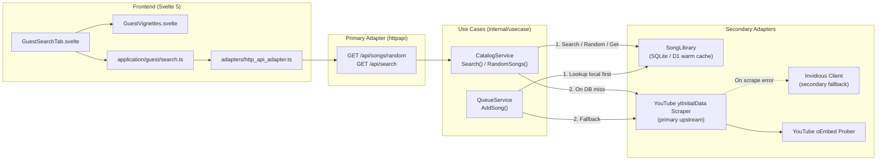

# Default Song Vignettes & YouTube `ytInitialData` Web Search Specification

**Status:** Draft — ready for implementation  
**Date:** 2026-10-25  
**Scope:** Random default song vignettes on the Guest Search screen + native Go YouTube `ytInitialData` scraping when a searched song is not present in the local database.  
**Related documents:** [`fana-karaoke-spec.md`](fana-karaoke-spec.md), [`ddd-architecture-spec.md`](ddd-architecture-spec.md), [`cloudflare-d1-spec.md`](cloudflare-d1-spec.md)

---

## 1. Summary

This specification covers two connected enhancements to **Fana Karaoke**:

1. **Default Song Vignettes on the Select Screen (`GuestSearchTab`)**:
   - When a user opens the **Search** tab on the Guest/Phone room view and has not typed a query yet (`q` is empty / `< 2` characters), the view displays up to **6 random songs** drawn from the current song database (`SongLibrary`) as a **2-column (mobile) / 3-column (desktop) visual vignette grid** with 16:9 thumbnail previews, duration overlay badges, title, channel, and an **Add** button.
   - Includes a **Shuffle / Refresh** action so guests can draw another random batch from the database at any time.
   - If the database is empty (0 songs) or disabled, the UI gracefully falls back to the existing microphone orb introduction.

2. **Native Go YouTube `ytInitialData` Scraper on Database Miss**:
   - When a user searches for a song and the local database (`SongLibrary`) returns **0 matches**, the Go backend fetches search results directly from YouTube's web search page (`https://www.youtube.com/results?search_query=...`) by extracting and parsing the embedded `ytInitialData` JSON payload using **only Go's standard library** (`net/http`, `regexp`, `encoding/json` — zero new external dependencies in `go.mod`).
   - Direct YouTube `ytInitialData` scraping acts as the **primary upstream search provider**, with the existing Invidious client retained as an automatic secondary fallback if YouTube scraping fails or is rate-limited.
   - Scraped results pass through the existing queueability rules (60s–600s, non-live, non-Shorts, valid 11-char ID) and concurrent YouTube oEmbed embeddability prober (`keepEmbeddable`), and are cached best-effort into the local `SongLibrary` (`Cache(ctx, results)`) so subsequent searches and default song vignettes immediately benefit from them.
   - Single-video metadata lookup (`AddSong`) checks the local `SongLibrary` first before hitting upstream/oEmbed, ensuring instant queueing when selecting a default vignette or cached search result.

---

## 2. Decisions Captured During the Interview

| Topic | Decision |
| --- | --- |
| Target screen for vignettes | **Guest Search tab (`GuestSearchTab.svelte`)** when the search input is empty (`< 2` chars) |
| Vignette layout | **2-column (mobile) / 3-column (desktop) visual card grid** above the "Paste a YouTube link" card |
| Vignette batch size & refresh | **6 random songs** per batch + a **Shuffle / Refresh** button to load a new random set |
| Vignette card anatomy | **16:9 thumbnail image preview** with overlaid **duration badge**, 2-line clamped **title**, **channel name**, and an explicit **Add** button that opens the existing `"Who's singing?"` nickname modal |
| Empty database fallback | Fall back to the **existing microphone orb intro** (`room.searchHint` / `room.searchMin`) when the database has 0 songs |
| Web search trigger | Triggered **only when a user search query returns 0 matches** in the local database (`SongLibrary`) |
| Upstream search strategy | **Primary: YouTube `ytInitialData` scraper** in native Go; **Fallback: existing Invidious instances** |
| Go JSON parsing | **Standard library `encoding/json` only** (zero new dependencies in `go.mod`) |
| YouTube GDPR / consent handling | Send **`SOCS` / `CONSENT` cookies** + `hl`/`gl` region query parameters alongside the browser `User-Agent` header so EU/FR servers never get stuck on YouTube's cookie consent wall |
| Embeddability & DB caching | Keep the **concurrent YouTube oEmbed prober (`keepEmbeddable`)** on scraped results and **auto-cache results into `SongLibrary`** |
| Single-video `Lookup` on `AddSong` | **Check local `SongLibrary` first**, then catalog cache / upstream / YouTube oEmbed |
| HTTP API endpoint for vignettes | Dedicated public endpoint **`GET /api/songs/random?limit=6`** (rate-limited per IP like `/api/search`) |
| Random sampling per backend | **Cloudflare D1 adapter:** sample randomly in Go memory from the warm cache (**0 D1 row reads consumed**); **Local SQLite adapter:** `SELECT ... FROM songs ORDER BY RANDOM() LIMIT ?` |
| Architecture constraints | Strictly enforce all rules in `internal/architecture/*_test.go`: **<= 300 lines per file** (raw & SLOC), **<= 40 lines per function** (raw & SLOC), and strict **Hexagonal DDD import boundaries** |

---

## 3. Architecture & Hexagonal Layering

All changes respect the repository's strict hexagonal architecture and file/function size gates (`go test ./internal/architecture/...`).



### 3.1 File Size & Function Size Budget
Because `internal/architecture` enforces **<= 300 lines per file** and **<= 40 lines per function**:
- Instead of bloating `GuestSearchTab.svelte` (currently 254 lines), the vignette grid is extracted into a dedicated presentational component: `web/src/ui/guest/GuestVignettes.svelte` (~140 lines).
- Instead of bloating `internal/adapters/secondary/invidious/client.go` (currently 136 lines), the YouTube `ytInitialData` scraper and parser live in dedicated files inside the catalog adapter package (`yt_scraper.go` and `yt_parser.go`, each <= 180 lines, with every function <= 40 lines).

---

## 4. Backend Specification

### 4.1 Ports (`internal/ports`)

#### Driving Port (`internal/ports/input.go`)
Extend `CatalogQueries` with `RandomSongs`:

```go
// CatalogQueries searches YouTube karaoke tracks and samples library suggestions.
type CatalogQueries interface {
	Search(ctx context.Context, query string) ([]domain.SearchResult, bool, error)
	RandomSongs(ctx context.Context, limit int) ([]domain.SearchResult, error)
}
```

#### Driven Port (`internal/ports/output.go`)
Extend `SongLibrary` with `Random` and `Lookup` (or `Get`):

```go
type SongLibrary interface {
	Search(ctx context.Context, query string, limit int) ([]domain.SearchResult, error)
	Random(ctx context.Context, limit int) ([]domain.SearchResult, error)
	Lookup(ctx context.Context, videoID string) (domain.VideoMeta, bool)
	Cache(ctx context.Context, songs []domain.SearchResult) error
	Save(ctx context.Context, songs []domain.SearchResult) error
	Count(ctx context.Context) (int, error)
	Status(ctx context.Context) LibraryStatus
	Export(ctx context.Context, format LibraryFormat, w io.Writer) error
	Import(ctx context.Context, format LibraryFormat, r io.Reader) (int, error)
}
```

### 4.2 Local Database Random Sampling & Lookup

#### 1. Local SQLite Adapter (`internal/adapters/secondary/sqlite/library.go`)
- **`Random(ctx, limit)`**:
  - Clamps `limit` to `[1, MaxResults]` (default `6` when `<= 0`, max `20`).
  - Executes:
    ```sql
    SELECT video_id, title, channel, thumbnail_url, duration_seconds
    FROM songs
    ORDER BY RANDOM()
    LIMIT ?
    ```
  - Returns `[]domain.SearchResult{}` (empty slice, no error) when the table is empty.
- **`Lookup(ctx, videoID)`**:
  - Queries a single row by primary key `WHERE video_id = ?`.
  - If found and `duration_seconds > 0`, returns `(domain.VideoMeta{VideoID, Title, Channel, ThumbnailURL, DurationSeconds}, true)`.
  - If `duration_seconds == 0` (e.g. legacy oEmbed-only entry) or not found, returns `(domain.VideoMeta{}, false)` so upstream/oEmbed can enrich or validate if needed, or returns the stored metadata if valid under `domain.ValidateVideoMeta`. (Note: `ValidateVideoMeta` allows `DurationSeconds == 0` or `61..600`, so any valid stored song can be returned directly!).

#### 2. Cloudflare D1 Warm-Cache Adapter (`internal/adapters/secondary/d1/library.go` & `cache.go`)
- **`Random(ctx, limit)`**:
  - Operates **100% in memory** on `l.cache` without making any HTTP request to the Cloudflare Worker or reading any rows from D1 (preserving the 0-cost D1 read budget).
  - Under `c.mu.RLock()`, copies the map values into a slice `[]domain.SearchResult`, then performs a partial Fisher–Yates shuffle (`math/rand/v2`) for `k = min(limit, len(songs))` elements and returns those `k` items.
- **`Lookup(ctx, videoID)`**:
  - Under `c.mu.RLock()`, looks up `videoID` in `c.songs`.
  - If present, converts `domain.LibrarySong` to `domain.VideoMeta` and returns `(meta, true)`.

### 4.3 Use Cases (`internal/usecase`)

#### 1. `CatalogService.RandomSongs` (`internal/usecase/facade.go` or `library_service.go`)
```go
const DefaultRandomLimit = 6
const MaxRandomLimit = 20

// RandomSongs returns up to limit random tracks from the local library.
func (s *CatalogService) RandomSongs(ctx context.Context, limit int) ([]domain.SearchResult, error) {
	if s.Library == nil {
		return []domain.SearchResult{}, nil
	}
	if limit <= 0 {
		limit = DefaultRandomLimit
	}
	if limit > MaxRandomLimit {
		limit = MaxRandomLimit
	}
	songs, err := s.Library.Random(ctx, limit)
	if err != nil || songs == nil {
		return []domain.SearchResult{}, nil
	}
	return songs, nil
}
```
Note: If the library is disabled (`s.Library == nil`) or encounters a transient read error, `RandomSongs` returns an empty slice `[]` rather than failing the guest UI.

#### 2. `CatalogService.Search` (`internal/usecase/facade.go`)
Remains local-first, web-on-miss:
1. Trim query; if `< 2` runes, return `[]domain.SearchResult{}, false, nil`.
2. Query `s.Library.Search(ctx, query, 20)`. If `len(local) > 0`, return `local, false, nil` immediately.
3. Otherwise (0 local matches), call `s.Catalog.Search(ctx, query)` which now uses the **YouTube `ytInitialData` scraper** first and falls back to Invidious only if scraping fails.
4. On success, asynchronously/best-effort store the results in `s.Library.Cache(ctx, results)` so future searches and random vignettes include these newly discovered songs.

#### 3. `QueueService.lookup` (`internal/usecase/queue_service.go`)
When a guest clicks **Add** on a vignette or search result (`AddSong`):
1. Check `s.Library != nil`: call `if meta, ok := s.Library.Lookup(ctx, videoID); ok`.
2. If found in the local library and `domain.ValidateVideoMeta(meta) == nil`:
   - Refresh `last_seen_at` via `s.rememberSong(ctx, meta)` and return `meta` immediately without network calls to Invidious or YouTube.
3. Otherwise, fall back to `s.Catalog.Lookup(ctx, videoID)` -> validate -> `s.rememberSong(ctx, meta)`.

---

## 5. Native Go YouTube `ytInitialData` Scraper Specification

### 5.1 Overview & Request Construction (`internal/adapters/secondary/invidious/yt_scraper.go`)

When a song is not found in the local database, the catalog adapter searches YouTube directly using the lightweight `ytInitialData` scraping method:

1. **Search URL**:
   ```
   https://www.youtube.com/results?search_query=<url.QueryEscape(query)>&hl=en&gl=<region>
   ```
   - `query` is already normalized by `normalizeQuery(raw)` (which trims control chars, caps at 120 runes, and appends `" karaoke"` if not already present).
   - `gl` is set to the configured `YOUTUBE_REGION` (default `"FR"`), and `hl=en` ensures consistent duration/live badge text formatting when fallback text parsing is needed.

2. **HTTP Headers & GDPR Consent Cookie**:
   - `User-Agent`: `"Mozilla/5.0 (Windows NT 10.0; Win64; x64) AppleWebKit/537.36 (KHTML, like Gecko) Chrome/114.0.0.0 Safari/537.36"`
   - `Accept-Language`: `"en-US,en;q=0.9"`
   - `Cookie`: `"SOCS=CAISHAgBEhJnd3NfMjAyMzA4MTUtMF9SQzIaAmVuIAEaBgiAo_CmBg; CONSENT=YES+cb.20210328-17-p0.en+FX+417"`
     *(Prevents YouTube from returning the `consent.youtube.com` interstitial page when the server runs in European data centers such as Render Frankfurt).*

3. **Timeout & Body Cap**:
   - Per-request timeout: `5 * time.Second` (via `context.WithTimeout`).
   - Response body read capped at `8 << 20` (8 MB) via `io.LimitReader` for memory safety.

### 5.2 Extracting `ytInitialData` (`internal/adapters/secondary/invidious/yt_parser.go`)

1. **Regex Extraction**:
   ```go
   var ytInitialDataRE = regexp.MustCompile(`(?:var\s+ytInitialData|window\["ytInitialData"\])\s*=\s*(\{.*?\});\s*</script>`)
   ```
   - Matches `var ytInitialData = {...};</script>` (as well as `window["ytInitialData"] = {...};</script>`).
   - If no match is found or HTTP status is non-200, return an error so the client can fall back to Invidious.

2. **Standard Library JSON Unmarshaling (`encoding/json`)**:
   Define lightweight, focused Go structs matching YouTube's search tree without external libraries:

   ```go
   type ytInitialData struct {
   	Contents struct {
   		TwoColumnSearchResultsRenderer struct {
   			PrimaryContents struct {
   				SectionListRenderer struct {
   					Contents []struct {
   						ItemSectionRenderer struct {
   							Contents []struct {
   								VideoRenderer *ytVideoRenderer `json:"videoRenderer"`
   							} `json:"contents"`
   						} `json:"itemSectionRenderer"`
   					} `json:"contents"`
   				} `json:"sectionListRenderer"`
   			} `json:"primaryContents"`
   		} `json:"twoColumnSearchResultsRenderer"`
   	} `json:"contents"`
   }

   type ytText struct {
   	SimpleText string `json:"simpleText"`
   	Runs       []struct {
   		Text string `json:"text"`
   	} `json:"runs"`
   }

   type ytVideoRenderer struct {
   	VideoID      string `json:"videoId"`
   	Title        ytText `json:"title"`
   	OwnerText    ytText `json:"ownerText"`
   	LongByline   ytText `json:"longBylineText"`
   	ShortByline  ytText `json:"shortBylineText"`
   	LengthText   ytText `json:"lengthText"`
   	Badges       []struct {
   		MetadataBadgeRenderer struct {
   			Style string `json:"style"`
   			Label string `json:"label"`
   		} `json:"metadataBadgeRenderer"`
   	} `json:"badges"`
   	ThumbnailOverlays []struct {
   		ThumbnailOverlayTimeStatusRenderer struct {
   			Style string `json:"style"`
   			Text  ytText `json:"text"`
   		} `json:"thumbnailOverlayTimeStatusRenderer"`
   	} `json:"thumbnailOverlays"`
   	NavigationEndpoint struct {
   		CommandMetadata struct {
   			WebCommandMetadata struct {
   				URL string `json:"url"`
   			} `json:"webCommandMetadata"`
   		} `json:"commandMetadata"`
   	} `json:"navigationEndpoint"`
   }
   ```

3. **Field Extraction & Filtering Rules**:
   - **`VideoID`**: `v.VideoID` — must satisfy `domain.ValidVideoID(id)` (11 chars).
   - **`Title`**: `v.Title.String()` (concatenates `Runs[].Text` or uses `SimpleText`), HTML-unescaped and trimmed.
   - **`Channel`**: First non-empty of `v.OwnerText.String()`, `v.LongByline.String()`, `v.ShortByline.String()`.
   - **`DurationSeconds`**: Parsed from `v.LengthText.String()` (or fallback `ThumbnailOverlays[].ThumbnailOverlayTimeStatusRenderer.Text.String()`), where `"MM:SS"` -> `M*60 + S` and `"HH:MM:SS"` -> `H*3600 + M*60 + S`.
   - **Live & Shorts Rejection**:
     - Reject if `LengthText` is empty (live streams have no `lengthText`).
     - Reject if any badge has `Style == "BADGE_STYLE_TYPE_LIVE_NOW"` or `ThumbnailOverlayTimeStatusRenderer.Style == "LIVE"` or `"SHORTS"`.
     - Reject if `NavigationEndpoint.CommandMetadata.WebCommandMetadata.URL` contains `"/shorts/"`.
     - Reject if `DurationSeconds <= domain.MinVideoSeconds` (60s) or `DurationSeconds > domain.MaxVideoSeconds` (600s).
   - **`ThumbnailURL`**: Standardized via `domain.ThumbnailURL(videoID)` (`https://i.ytimg.com/vi/<id>/mqdefault.jpg`).
   - **Deduplication & Cap**: Deduplicate by `VideoID`, keep at most `20` results.

### 5.3 Upstream Fallback Chain (`internal/adapters/secondary/invidious/client.go`)

In `Client.Search(ctx, query)`:
1. **Step 1 (Primary):** Call `c.searchYouTube(ctx, query)` (`ytInitialData` scraper).
   - If `err == nil` and `len(results) > 0`, return `results, nil`.
2. **Step 2 (Fallback):** If `searchYouTube` returns an error (e.g. network failure, layout change, consent block) or 0 parseable video items, fall back to the existing Invidious instance loop (`c.searchInvidious(ctx, query)`).
3. **Step 3 (Catalog Layer `Catalog.Search`):**
   - Pass the returned results through `c.keepEmbeddable(ctx, results)` (concurrent YouTube oEmbed check, max 8 goroutines, dropping videos with HTTP 401/403 embed disabled).
   - Store in the in-memory query cache (`c.cache.StoreQuery(key, results)`).
   - Return to `CatalogService.Search`, which caches the songs into `SongLibrary` (`SQLite` or `D1`).

---

## 6. HTTP API Specification

### 6.1 `GET /api/songs/random`

Returns a random selection of songs from the current database for the Guest Search vignette screen.

- **Route:** `GET /api/songs/random` (registered in `internal/adapters/primary/httpapi/routes.go`)
- **Query Parameters:**
  - `limit` (optional): integer between `1` and `20`. Defaults to `6` if omitted or invalid.
- **Authentication:** Public (same as `GET /api/search`).
- **Rate Limiting:** `"random:" + s.clientIP(r)`, limit `60` requests per minute (generous enough for active shuffling during a party).
- **Headers:** `Cache-Control: no-store` (so every call returns a fresh random sample).
- **Response `200 OK`:**
  ```json
  {
    "results": [
      {
        "videoId": "dQw4w9WgXcQ",
        "title": "Rick Astley - Never Gonna Give You Up (Karaoke Version)",
        "channel": "Sing King",
        "thumbnailUrl": "https://i.ytimg.com/vi/dQw4w9WgXcQ/mqdefault.jpg",
        "durationSeconds": 213
      }
    ]
  }
  ```
  When the database has fewer than `limit` songs (e.g. 3 songs), returns all 3 in random order. When the database has `0` songs or is disabled, returns `{"results": []}` with HTTP `200 OK`.

---

## 7. Frontend Specification (Svelte 5 / TypeScript)

### 7.1 Ports & Adapters (`web/src/ports/api_port.ts` & `web/src/adapters/http_api_adapter.ts`)

Add `randomSongs` to `RoomApiPort`:
```ts
export interface RoomApiPort {
  // ... existing methods
  randomSongs(limit?: number): Promise<{ results: SearchResult[] }>;
}
```
And in `http_api_adapter.ts`:
```ts
randomSongs: (limit = 6) => request(fetcher, `/api/songs/random?limit=${limit}`),
```

### 7.2 Guest State & Search Controller (`web/src/application/guest/`)

#### `web/src/application/guest/state.ts`
Add two stores to `createGuestState()`:
```ts
suggestions: writable<SearchResult[]>([]),
loadingSuggestions: writable(false),
```

#### `web/src/application/guest/search.ts` & `controller.ts`
- Add `loadSuggestions(): Promise<void>` to `GuestSearch`:
  ```ts
  async loadSuggestions(): Promise<void> {
    if (get(this.state.loadingSuggestions)) return;
    this.state.loadingSuggestions.set(true);
    try {
      const res = await this.deps.api.randomSongs(6);
      this.state.suggestions.set(res.results ?? []);
    } catch {
      // Non-fatal: keep existing suggestions or empty state
    } finally {
      this.state.loadingSuggestions.set(false);
    }
  }
  ```
- In `controller.ts` `load()`: trigger `void search.loadSuggestions()` alongside room initialization so the 6 random vignettes are immediately ready when the guest lands on the Search tab.
- Expose `shuffleSuggestions: () => search.loadSuggestions()` from `createGuestSearch` and `createGuestController`.

### 7.3 Vignette Grid Component (`web/src/ui/guest/GuestVignettes.svelte`)

Create a new component `web/src/ui/guest/GuestVignettes.svelte` (<= 200 lines) rendered by `GuestSearchTab.svelte` when the user is not actively viewing search results (`!$searching && !$searched && $results.length === 0`):

- **Behavior**:
  - If `$suggestions.length > 0`:
    - Render a section header row with:
      - Label / title: `$tr('room.suggestionsTitle')` (EN: `"Suggested songs"`, FR: `"Suggestions de chansons"`)
      - A **Shuffle** button (`type="button"`, `on:click={onShuffle}`, disabled while `$loadingSuggestions` is true) with a shuffle/dice or refresh icon and `$tr('room.shuffle')` (EN: `"Shuffle"`, FR: `"Mélanger"`).
    - Render a responsive CSS Grid of vignette cards:
      - **Mobile (`< 640px`)**: 2 columns (`grid-template-columns: repeat(2, minmax(0, 1fr))`)
      - **Tablet/Desktop (`>= 640px`)**: 3 columns (`grid-template-columns: repeat(3, minmax(0, 1fr))`)
    - **Each Vignette Card (`.vignette.card`)**:
      - **Top media container (`.vignette-media`)**:
        - 16:9 `` preview (`src={song.thumbnailUrl}`, `loading="lazy"`, `width="320"`, `height="180"`, `object-fit: cover`).
        - Overlaid bottom-right pill badge (`.duration-badge`) showing `formatDuration(song.durationSeconds)` in monospace font over a semi-transparent dark backdrop (`rgb(8 5 15 / 0.82)`).
      - **Card body (`.vignette-body`)**:
        - Song title (`<p class="vignette-title clamp-2">{song.title}</p>`)
        - Channel name (`<p class="tiny dim truncate">{song.channel}</p>`)
        - Action button (`<button class="btn btn-primary btn-sm vignette-add" type="button" on:click={() => onChoose(song)} disabled={locked || full}>{$tr('room.add')}</button>`)
  - If `$suggestions.length === 0`:
    - Render the existing `.search-intro` microphone orb (`🎤`, `$tr('room.searchHint')`, `$tr('room.searchMin')`) so an empty database looks intentional and polished.

### 7.4 Internationalization (`web/src/application/i18n/en.ts` & `fr.ts`)

Add the following translation keys:

| Key | English (`en.ts`) | French (`fr.ts`) |
| --- | --- | --- |
| `room.suggestionsTitle` | `'Suggested songs'` | `'Suggestions de chansons'` |
| `room.shuffle` | `'Shuffle'` | `'Mélanger'` |

---

## 8. Edge Cases & Resilience

1. **Empty or Small Database (< 6 songs)**:
   - If the database has 0 songs, `GET /api/songs/random` returns `{"results": []}` and the UI displays the microphone orb intro.
   - If the database has 1–5 songs, the vignette grid displays those 1–5 cards cleanly without layout breakage.
2. **Newly Discovered Songs Automatically Feed Vignettes**:
   - Whenever a user searches for a song not in the database, `CatalogService.Search` scrapes YouTube `ytInitialData`, probes oEmbed, and calls `s.Library.Cache(ctx, results)`.
   - Tapping **Shuffle** on the Search tab immediately includes those newly cached songs in the random pool.
3. **YouTube Consent Wall / Layout Changes / Rate Limiting**:
   - The `SOCS` + `CONSENT` cookies bypass YouTube's EU GDPR interstitial wall.
   - Both `var ytInitialData = {...};</script>` and `window["ytInitialData"] = {...};</script>` script assignments are supported.
   - If YouTube blocks the IP or changes its JSON structure so 0 videos are extracted, `Client.Search` seamlessly falls back to the configured Invidious instances (`searchInvidious`), and if those also fail, serves stale cached query results if available.
4. **Queue Locked or Full**:
   - Just like search result rows, the **Add** button on every vignette card is disabled when `locked || full` is true.
5. **Embed-Blocked Videos**:
   - Because scraped `ytInitialData` results go through `keepEmbeddable` (concurrent oEmbed check) before being returned and cached in the database, non-embeddable videos are filtered out before they ever enter the database or appear as default vignettes.

---

## 9. Verification & Testing Plan

1. **Unit Tests (Go Backend)**:
   - `internal/adapters/secondary/invidious/yt_scraper_test.go`:
     - Test parsing real-shaped `ytInitialData` HTML payloads into `[]domain.SearchResult`.
     - Verify filtering of live streams, Shorts (`/shorts/` URL and `SHORTS` overlay), videos `<= 60s`, videos `> 600s`, and invalid video IDs.
     - Verify duration parsing (`"3:33"` -> `213`, `"1:02:05"` -> `3725`).
     - Verify fallback from YouTube `ytInitialData` scraper to Invidious when the YouTube endpoint returns an error or empty payload.
     - Verify `Cookie` (`SOCS` / `CONSENT`) and `User-Agent` headers are sent on the YouTube request.
   - `internal/adapters/secondary/sqlite/library_test.go` & `internal/adapters/secondary/d1/library_test.go`:
     - Test `Random(ctx, 6)` on empty DB (returns 0), DB with 3 songs (returns 3), and DB with 20 songs (returns 6 distinct songs).
     - Test `Lookup(ctx, videoID)` returns stored metadata when present.
   - `internal/usecase/catalog_test.go`:
     - Test `RandomSongs` limits and empty/nil library handling.
     - Test `AddSong` uses `Library.Lookup` first before hitting `Catalog.Lookup`.
   - `internal/adapters/primary/httpapi/library_test.go`:
     - Test `GET /api/songs/random?limit=6` HTTP status, JSON schema, and rate limiting.
2. **Architecture Tests**:
   - Run `go test ./internal/architecture/...` to confirm all new/modified `.go`, `.ts`, `.svelte`, and `.css` files stay `<= 300` lines and all functions stay `<= 40` lines, with zero hexagonal import violations.
3. **Frontend Typecheck & Build**:
   - Run `cd web && npm run check && npm run build`.
4. **End-to-End Tests**:
   - Verify that opening a room with songs in the library displays the vignette grid with image previews on the Search tab, clicking Shuffle refreshes the vignettes, and clicking Add on a vignette opens the nickname modal and queues the song.
